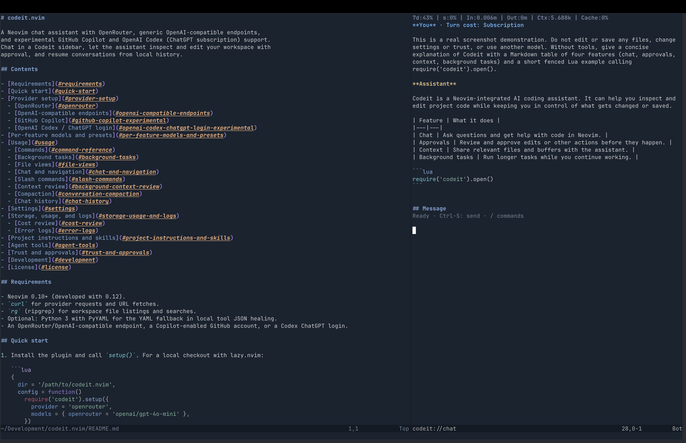
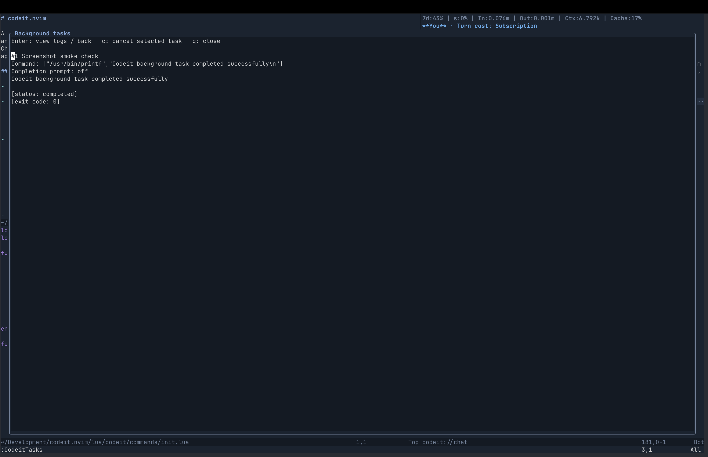
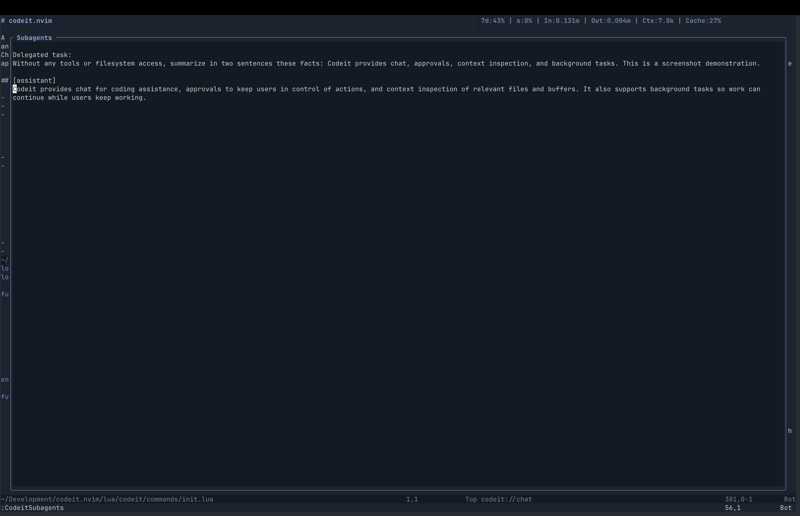
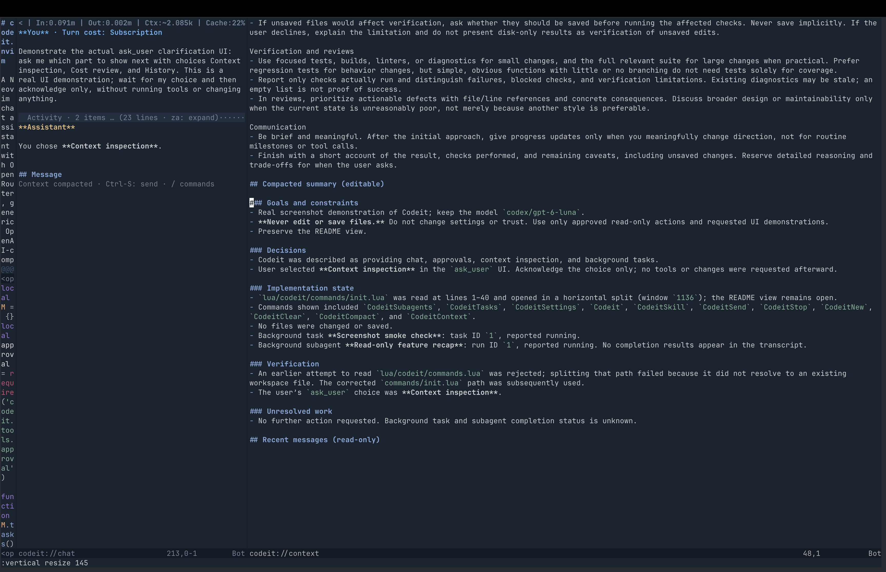
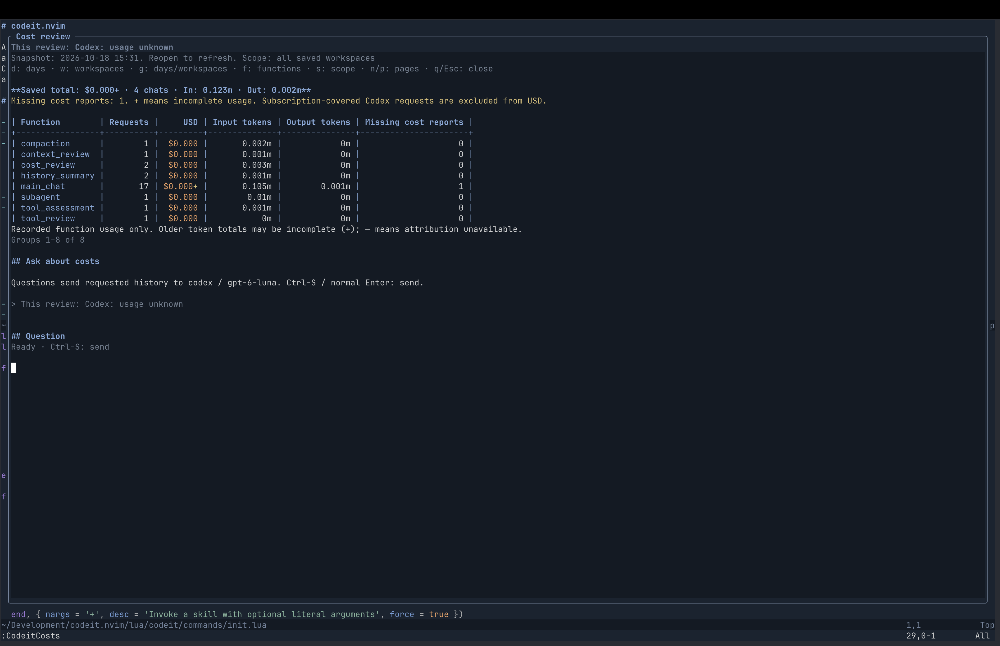
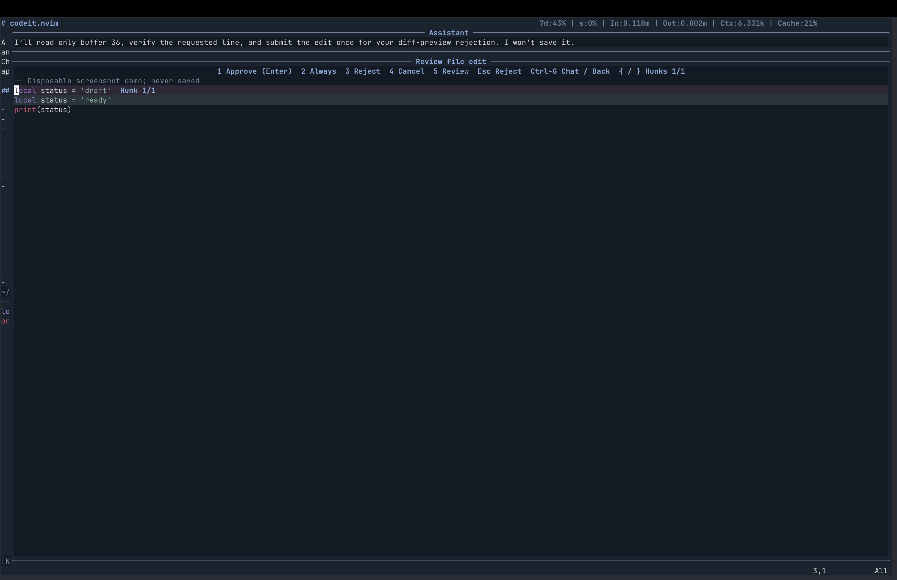

# codeit.nvim

A Neovim chat assistant with OpenRouter, generic OpenAI-compatible endpoints,
and experimental GitHub Copilot and OpenAI Codex (ChatGPT subscription) support.
Chat in a Codeit sidebar, let the assistant inspect and edit your workspace with
approval, and resume conversations from local history.



The sidebar keeps the conversation, draft, and usage visible alongside an ordinary
file view.

## Contents

- [Requirements](#requirements)
- [Quick start](#quick-start)
- [Provider setup](#provider-setup)
  - [OpenRouter](#openrouter)
  - [OpenAI-compatible endpoints](#openai-compatible-endpoints)
  - [GitHub Copilot](#github-copilot-experimental)
  - [OpenAI Codex / ChatGPT login](#openai-codex-chatgpt-login-experimental)
- [Per-feature models and presets](#per-feature-models-and-presets)
- [Usage](#usage)
  - [Commands](#command-reference)
  - [Background tasks](#background-tasks)
  - [File views](#file-views)
  - [Chat and navigation](#chat-and-navigation)
  - [Slash commands](#slash-commands)
  - [Context review](#background-context-review)
  - [Compaction](#conversation-compaction)
  - [Chat history](#chat-history)
- [Settings](#settings)
- [Storage, usage, and logs](#storage-usage-and-logs)
  - [Cost review](#cost-review)
  - [Error logs](#error-logs)
- [Project instructions and skills](#project-instructions-and-skills)
- [Agent tools](#agent-tools)
- [Trust and approvals](#trust-and-approvals)
- [Development](#development)
- [License](#license)

## Requirements

- Neovim 0.10+ (developed with 0.12).
- `curl` for provider requests and URL fetches.
- `rg` (ripgrep) for workspace file listings and searches.
- Optional: Python 3 with PyYAML for the YAML fallback in local tool JSON healing.
- An OpenRouter/OpenAI-compatible endpoint, a Copilot-enabled GitHub account, or a Codex ChatGPT login.

## Quick start

1. Install the plugin and call `setup()`. For a local checkout with lazy.nvim:

   ```lua
   {
     dir = '/path/to/codeit.nvim',
     config = function()
       require('codeit').setup({
         provider = 'openrouter',
         models = { openrouter = 'openai/gpt-4o-mini' },
       })
     end,
   }
   ```

2. Set `OPENROUTER_API_KEY` before starting Neovim, or configure an
   [OpenAI-compatible endpoint](#openai-compatible-endpoints),
   [Copilot authentication](#github-copilot-experimental), or a
   [Codex ChatGPT login](#openai-codex-chatgpt-login-experimental).
3. Open `:Codeit`, type below `## Message`, and send with `<CR>` in normal mode
   or `<C-s>` in insert mode.
4. Review tool approvals as they appear. Optionally use `:CodeitTrust` to
   auto-approve workspace reads; edits and commands still require approval.

Codeit opens a dedicated tab with a chat sidebar and ordinary file views. The
initial view shows the buffer you were using. Closing the sidebar returns to your
previous tab, keeping the conversation, file layout, and unsaved buffers; reopening
Codeit restores its tab. Use `:CodeitNew` for a fresh chat or `:CodeitHistory` to
resume an earlier one.

Codeit notifications appear in a rounded, bordered popup at the top right of the
terminal, without taking focus. Messages are labeled and highlighted by severity
(`CodeitNotifyERROR`, `CodeitNotifyWARN`, `CodeitNotifyINFO`, `CodeitNotifyDEBUG`,
and `CodeitNotifyTRACE`). Each message expires independently after four seconds;
the popup closes when the last message expires and follows you across tabs. If
the stack exceeds the terminal height, the newest messages remain visible.
Notifications from other plugins continue to use your existing notifier.

For navigation, file views, and appearance options, see [Usage](#usage).

<details>
<summary>Optional setup settings</summary>

Call `require('codeit').setup()` with the options you need. You can also manage
provider, model, preset, request, and context-limit settings through `:CodeitSettings`.
Choose **Max context length (tokens)** to enter a positive token limit, leave it
blank to detect the provider's limit automatically, or enter `false` to disable
automatic compaction. Apply it for the session or save it globally/per workspace.

```lua
require('codeit').setup({
  provider = 'openrouter', -- or 'openai' / 'copilot' / 'codex'
  models = {
    openrouter = 'openai/gpt-4o-mini',
    copilot = 'gpt-4o',
    codex = 'gpt-5.3-codex',
    openai = 'gpt-4o-mini',
  },
  -- model_presets = {
  --   fast = { model = 'openai/gpt-4o-mini', options = { effort = 'low' } },
  --   long_context = { provider = 'copilot', model = 'gpt-4o' },
  --   reasoning = { model = 'openai/gpt-4o', options = { effort = 'high' } },
  -- }, -- unset fields inherit main chat settings
  -- feature_settings = {
  --   tool_review = { preset = 'reasoning' }, -- also the default for this feature
  --   compaction = { preset = 'long_context', options = { api_host = '' } },
  --   history_summary = { model = 'openai/gpt-4o-mini' }, -- optional per-feature override
  -- }, -- see "Per-feature models and presets" below
  -- request_options = {
  --   openrouter = { routing_mode = 'throughput', effort = 'high' }, -- auto, price, latency, or throughput
  --   copilot = { api_host = 'api.business.githubcopilot.com', effort = 'high' }, -- host defaults to api.githubcopilot.com
  --   codex = { effort = 'high' }, -- optional; model-dependent
  --   openai = { base_url = 'http://localhost:1234/v1', api_key_env = '' }, -- keyless local server
  -- },
  -- system_prompt = 'You are a helpful Neovim coding assistant.',
  -- max_tool_rounds = 12, -- tool-call batches per user turn; prompts before exceeding this
  -- max_subagent_tool_rounds = 40, -- separate hard cap per subagent; never prompts
  -- tool_json_healing = false, -- disable local tool argument repair for all providers (default: true)
  -- context_review = false, -- disable background pruning after each completed turn (default: true)
  -- personal_wiki = { enabled = true, root = vim.fn.stdpath('data') .. '/codeit/wiki' },
  -- max_context_tokens = 128000, -- optional manual override; false disables auto-compaction
  -- approval = {
  --   trusted_workspaces = {
  --     ['/absolute/path/to/project'] = 'all',     -- auto-approve reads inside this workspace
  --     ['/absolute/path/to/other'] = 'tracked',   -- auto-approve only Git-tracked file reads
  --   },
  --   validators = {
  --     function(name, args, context)
  --       -- return 'approve', 'ask', or 'reject', optionally with a reason
  --       if name == 'run_command' and args.argv and args.argv[1] == 'rm' then
  --         return 'reject', 'Deletion commands are disabled'
  --       end
  --       -- context.workspace and context.user_request are available here
  --     end,
  --   },
  -- },
})
```

</details>

## Personal wiki

The optional personal wiki agent reviews each completed turn in the background,
extracts durable facts, preferences, decisions, and reusable knowledge, and maintains
categorized Markdown pages such as `projects/codeit.md` or `preferences/editor.md`.
It is **disabled by default**. In `:CodeitSettings`, enable **Automatic wiki updates**
and optionally change **Wiki root directory** (an absolute path), then apply/save.
The default root is `vim.fn.stdpath('data') .. '/codeit/wiki'`, shared across workspaces.
You can also set `personal_wiki = { enabled = true, root = '/absolute/path/to/wiki' }`
in `setup()`. Configure the agent model under **Personal wiki agent** in feature
overrides, or `feature_settings.personal_wiki`; it uses the long context preset by default.

Enabling this feature authorizes automatic creation and updates **inside that root**,
without per-page approval. Turn details and relevant wiki content are sent to the
configured model. Generating missing or stale page summaries also sends those
pages' full contents to that model, even if they do not match the turn's search. The agent is instructed not to retain secrets or speculation,
but this is not a guarantee of sensitive-data filtering: enable it only for turns
you are comfortable retaining and sending to that provider. Inspect/edit the Markdown
files directly; wiki notes are **not automatically injected into main-chat context**.

Pages use Obsidian-compatible YAML properties, with the title in frontmatter rather
than a duplicate opening heading:

```markdown
---
title: Editor preferences
tags:
  - tools/editor
aliases:
  - Editing setup
---

Uses Neovim.
```

The agent is instructed to preserve custom properties and existing tags/aliases.
Search includes frontmatter, so title, tag names (without `#`), and alias text can
find pages using the same literal matching as body text. There is no separate
YAML index or tag-query syntax; frontmatter validation checks structure and the
presence of a title, not the full YAML specification.

On the next automatic review, legacy pages starting with `# Title` are migrated
locally: the heading becomes a quoted `title` property, empty `tags` and `aliases`
lists are added, and the remaining body is preserved. No model call is needed for
the conversion itself; missing/stale summaries are refreshed first as usual.
Migration uses the normal conflict/unsaved-buffer checks and local Git commits
(in batches of up to 80 pages), and updates summary fingerprints. Pages already
using frontmatter are not migrated; imported pages without an opening title
heading are left alone. No pages are migrated while automatic reviews are disabled.

You can open the wiki root as an Obsidian vault. Codeit only recognizes its
`category/page.md` layout, not arbitrary vault names or nested folders. Obsidian's
`.obsidian` directory and other unrecognized files are left alone. Hidden
`category/.page.md` files are internal summary caches, not notes. The agent prefers
relative Markdown links and is instructed to preserve existing wikilinks, but
Codeit does not resolve Obsidian links, embeds, or backlinks. Obsidian's standard
note name remains the filename; `title` is a property, while `aliases` supplies
alternative link names.

Git must be installed. The wiki initializes its own Git repository at the root if
one does not exist, using Git's configured default branch. Existing recognized wiki
pages are captured in an initial commit when the new repository is first cataloged.
Each changed update batch creates one local commit on the currently checked-out
branch; unchanged batches create no commit. No branches are switched, no remotes
are configured, and nothing is pushed or fetched. Detached-HEAD updates are rejected.
Automated commits use `Codeit <codeit@localhost>` and disable hooks and signing for
those commands only, without changing your Git configuration. Only the affected
wiki pages and their hidden preview files are committed; unrelated staged or
unstaged changes are left alone. Staged changes to an affected page or preview
abort the update before writing. Inspect history
with `git -C /absolute/path/to/wiki log -p` or your preferred Git viewer.

The agent extracts retention notes and search phrases from the completed turn.
Those phrases are searched locally against wiki paths and full page contents using
case-insensitive literal substring matching (any phrase may match). Only matching
paths and previews are sent back, not the full page catalog. The agent then selects
matching pages to read in full before merging notes; with no matches it may create
a new topic. Each `category/page.md` has a hidden `category/.page.md` preview file
containing a model-generated summary of the complete page and a source-content
fingerprint. Search-result previews contain that summary, never a byte excerpt.
Page updates generate and commit the summary alongside the main file. At the
start of each review, missing summaries and summaries invalidated by manual or
external edits are regenerated in batches before any search previews are returned.
External edits are detected at the next review, not by a background watcher.
Summary-only refreshes do not rewrite or commit the manually edited main pages.
Reviews with retained notes use three model requests: search planning, page
selection, and updating, plus any requests needed to refresh summaries. Project facts retain
workspace scope. Reviews are serialized within this Neovim session, do not block
new turns, and are discarded if the originating chat/workspace changes or wiki
settings change. Disabling prevents pending updates but does not delete existing
notes. Only completed turns are reviewed; failed/interrupted turns are not replayed.

Expand **Activity** at the end of a turn to inspect its **Wiki review** summary:
status, the agent's retention notes, selected and updated page paths, and any
skip/error reason. Summaries update in the background and are saved with chat
history, without page contents or diffs. Older turns have no retrospective summary.
Unfinished saved reviews appear as cancelled when history is reloaded; reviews
are not resumed. These notes describe the agent's decision, not private reasoning.

Paths are restricted to `category/page.md` with lowercase kebab-case names of up to
200 characters each (excluding `.md`);
symlink categories/pages/previews are not followed. Conflicting disk changes or
unsaved edits to a page or its preview abort an update. Writes are atomic per file,
not across a page/preview pair or an entire batch.
The local index supports up to 5,000 catalog pages (10 MiB total for paths and
summaries). Each review searches up to 20 phrases of at most 200 bytes each
and returns up to 80 matches in path order, with summaries of up to 5,000 bytes.
Summary generation uses batches of at most 80 pages, targeting 1.25 MiB of encoded
page data per request (an individually larger encoded page is sent alone). Reviews
support 80 selected/updated pages per turn, 320 KiB per page, and 1.25 MiB per turn. The review queue holds up
to 16 pending reviews per session. Large reviews can increase model costs and may
exceed the provider's context limits.
Over-limit or failed reviews warn and leave the remaining wiki unchanged; they are
not retried automatically. A Git failure after page writes leaves those edits on
disk and reports the review as failed; newly staged wiki changes are unstaged when
possible, without disturbing previously staged work. Git commits do not make a
multi-page write transactional. Keep the wiki root in a trusted, user-owned directory;
path checks are not a sandbox against another process maliciously changing the
directory tree during an update. Concurrent Neovim instances should not maintain
the same wiki simultaneously.

## Provider setup

### OpenRouter

For OpenRouter, set `OPENROUTER_API_KEY` in the environment before starting Neovim. Requests are sent to `https://openrouter.ai/api/v1/chat/completions` using OpenAI-compatible chat completions. Choose a model with tool-calling support to use editor tools.

### OpenAI-compatible endpoints

Use `provider = 'openai'` for OpenAI's API or a server implementing OpenAI-style
`/chat/completions`. The default base URL is `https://api.openai.com/v1`; set
`OPENAI_API_KEY` before starting Neovim for OpenAI's separately billed API.
For another endpoint, configure the API root including its version prefix:

```lua
require('codeit').setup({
  provider = 'openai',
  models = { openai = 'your-tool-capable-model' },
  request_options = {
    openai = {
      base_url = 'http://localhost:1234/v1',
      api_key_env = '', -- no authentication; or 'MY_SERVER_API_KEY'
    },
  },
  -- max_context_tokens = 32768, -- use your model's limit if metadata omits it
})
```

**Base URL** and **API key environment variable** are also available in
`:CodeitSettings`, including preset and feature overrides. Unset or blank
`base_url` uses OpenAI's default URL. Unset `api_key_env` reads `OPENAI_API_KEY`;
blank disables authentication. Missing or empty environment variables omit the
Authorization header, supporting keyless local servers. Only the variable name,
not its secret value, is saved. When configuring another server, explicitly
choose its key variable or disable authentication to avoid sending your OpenAI
key to that server. Use HTTPS for remote servers carrying credentials.

Requests support streaming, tool calls, and reported token usage. Choose a model
with tool-calling support. Model browsing uses `GET <base_url>/models`; if your
server does not implement it, enter a model ID manually. Context-limit detection
uses `context_length` when reported; otherwise set `max_context_tokens` manually.
No dollar cost is estimated when the endpoint omits `usage.cost`. This backend
uses Chat Completions, not OpenAPI specifications or the Responses API.

### GitHub Copilot (experimental)

For Copilot, sign in using `:Copilot setup` in copilot.vim or `:Copilot auth` in copilot.lua with a Copilot-enabled GitHub account. The plugin reuses their OAuth credentials from `github-copilot/apps.json` or `hosts.json` under `$XDG_CONFIG_HOME` (default `~/.config`, or `%LOCALAPPDATA%` on Windows). Explicit environment credentials take precedence: `COPILOT_GITHUB_TOKEN`, then `GH_TOKEN`, then `GITHUB_TOKEN` (empty values are skipped). If none are available, it falls back to `gh auth token --hostname github.com`. **A GitHub CLI login or personal access token is not necessarily accepted by the Copilot token endpoint**, even for an account with Copilot access; if the exchange returns HTTP 401/403, use a Copilot OAuth login instead.

The plugin exchanges the OAuth credential for a short-lived Copilot token, then routes requests using the model catalog's `supported_endpoints`: `/chat/completions` when available, or `/responses` for Responses-only models. Endpoint metadata is cached per Copilot API host for the session and refreshed when searching models. If metadata omits endpoints (or the manually entered ID is absent), the plugin retains the legacy chat-completions path; models advertising only unsupported endpoints return an error asking you to choose another model. Responses requests replay the transcript, tool calls/results, and encrypted reasoning without server-side conversation storage. Credentials are not printed or logged by the exchange handler.

**Compatibility warning:** This integration uses GitHub's internal, undocumented API and may break or require different credentials; it is not the OpenRouter API and does not use an OpenRouter key.

### Copilot business API host

To use Copilot behind a business network policy, set `request_options.copilot.api_host = 'api.business.githubcopilot.com'` in `setup()`, or choose **Copilot API host** in `:CodeitSettings` after selecting Copilot. The setting can be applied for the session or saved globally/per workspace, and is stored with chats. It routes Copilot chat requests, model searches, and context-limit metadata to the business host unless a feature overrides `options.api_host`; there is no fallback to the standard host. Unset or blank uses `api.githubcopilot.com`. Only these two hostnames are accepted, without a URL scheme or path. Authentication still exchanges credentials at `https://api.github.com/copilot_internal/v2/token`, so that endpoint must remain reachable. Saved settings override `setup()` options as described below.

### OpenAI Codex (ChatGPT login, experimental)

This provider uses your Codex/ChatGPT subscription, **not** an OpenAI API key or
OpenAI's separately billed API. Sign in with `codex login`, then configure:

```lua
require('codeit').setup({
  provider = 'codex',
  models = { codex = 'gpt-5.3-codex' },
  -- request_options = { codex = { effort = 'high' } },
})
```

Codeit reads `$CODEX_HOME/auth.json` (default `~/.codex/auth.json`) before each
request. Only file-backed ChatGPT credentials are supported. If the CLI stores
credentials in an OS keychain, set `cli_auth_credentials_store = "file"` in its
`config.toml` and sign in again. API-key logins are rejected; Codeit does not fall
back to `OPENAI_API_KEY`. Credentials are never saved in Codeit settings/history,
and provider errors redact access, ID, and refresh tokens.

Requests go to `https://chatgpt.com/backend-api/codex/responses` with your account
ID, using stateless Responses requests (`store = false`). Tool calls/results and
encrypted reasoning are replayed between rounds. Model browsing and context-window
lookup use the same backend's model catalog. Choose an available model through
`:CodeitSettings`, or enter its ID manually; access depends on your account.
Reasoning effort is optional and model-dependent.

Codeit does **not** refresh or overwrite the CLI's shared credentials. If they
expire or the backend returns HTTP 401, run `codex login` again and retry; CLI
credential changes are picked up without restarting Neovim. The backend requires
streaming even for internal reviews/summaries, but those requests do not display
live previews. It does not accept `max_output_tokens`, so internal summary token
caps are not sent; summary-size targets still apply through the prompt. Token and
cache usage are recorded when reported. The billing line shows the latest reported
Codex subscription usage windows (percent **used**), followed by other providers'
chat costs in parentheses, for example `Codex: 5h 23% used · 7d 41% used ($0.012)`.
Subscription usage refreshes from response headers/stream events after Codex
requests; it is account-wide, not usage attributable to this chat. Before a report
arrives, or once a reported window expires, usage is shown as unknown. Snapshots
are not restored from saved chats. Only the default Codex quota pool is displayed.
Codex subscription-covered requests are excluded from per-request USD totals and
missing-dollar-cost counts; no API-equivalent prices are estimated. This does not
mean the subscription is free. Other providers' reported charges (including
secondary reviews, summaries, and subagents) still contribute to dollar totals;
`+` inside the parentheses means some of those dollar costs were not reported.
Saved cost breakdowns retain a `subscription_requests` count; older unknown costs
are left unchanged.

**Compatibility warning:** This is the Codex CLI's subscription backend, not a
stable public API. It may change independently of Codeit.

## Per-feature models and presets

Three shared presets are available: **fast** (`fast`), **long context** (`long_context`), and **reasoning** (`reasoning`). Configure them in `model_presets`, with optional `provider` (`openrouter`, `copilot`, or `codex`), `model`, and `options` fields. Presets start empty: they do not pick fixed models or force request options. Unset or blank `provider` and `model` inherit the main backend/model (the current chat's model for the same backend, or the configured main model for another backend). Omitted request-option keys inherit from `request_options` for the resolved backend.

Each feature automatically uses a preset suited to its requests:

| Feature key | Requests | Default preset |
| --- | --- | --- |
| `tool_assessment` | Automatic tool risk/approval assessments | fast |
| `tool_review` | Interactive **Ask reviewer** questions and follow-ups | reasoning |
| `context_review` | Background per-turn context pruning | long context |
| `history_summary` | Descriptions generated by `:CodeitHistory` | fast |
| `compaction` | Both manual and automatic conversation compaction | long context |
| `cost_review` | Questions in `:CodeitCosts` | fast |
| `subagent` | Delegated tasks with normal tool approvals | fast |

Entries in `feature_settings` can select a different `preset` using its key. Omit `preset` to use the default above; set `preset = ''` to skip the preset. Features can still independently override `provider`, `model`, and `options`. Resolution is main backend settings → selected preset → explicit feature overrides. Unset or blank feature `provider`/`model` inherit from the preset. Changing a shared preset updates every feature using it, without affecting the main chat request.

The former `secondary_models` setting is no longer used. Old settings and chats still load, but that field is ignored; move any desired model choices into `model_presets` or `feature_settings`.

`options` override individual keys. Omitted keys inherit; `''` explicitly clears a key to the API default, even if the preset or main request has a value. OpenRouter supports `routing_mode`, `preferred_provider`, `allow_fallbacks`, `response_healing`, `service_tier`, and `effort`; Copilot supports `api_host`; Codex supports `effort`. Options belonging to the other backend are not sent. Presets and features may use a different backend from the main chat, so credentials/access for all selected backends are required. Explicit model IDs must match the resolved backend; if a feature overrides a preset's backend, also override its model when the preset has an explicit model.

OpenRouter's **Routing mode** selects `auto` (automatic routing), `price` (lowest price), `latency` (lowest latency), or `throughput` (highest throughput). An explicit mode ignores `preferred_provider`, including inherited values; service tier and reasoning effort remain independent and are still sent when configured. Sorted modes send OpenRouter's `provider.sort` setting, while `auto` leaves routing to OpenRouter. Omit `routing_mode` to inherit it, or set it to `''` (**Use preferred provider**) to disable the mode and use the existing preferred-provider setting. Existing configurations without a routing mode keep their behavior. This option is available for main chat, shared presets, and individual features.

OpenRouter's **Provider fallback** controls `provider.allow_fallbacks`: set `allow_fallbacks = true` to allow fallback to other providers, or `false` to disable it. It works independently of routing mode, preferred provider, and service tier. Omitted values inherit; `''` (**provider default**) clears an inherited value and omits the API field. Without an explicit value, OpenRouter's default applies (fallbacks enabled). Main chat, presets, and feature overrides expose this setting in `:CodeitSettings`. For example: `request_options = { openrouter = { routing_mode = 'price', allow_fallbacks = false } }`.

OpenRouter's **JSON response healing** enables its [Response Healing plugin](https://openrouter.ai/docs/guides/features/plugins/response-healing). Set `response_healing = true` to send `plugins = { { id = 'response-healing' } }` with `response_format = { type = 'json_object' }`. This opts the request into JSON-only message output and disables streaming, as required by OpenRouter. It attempts to repair malformed JSON message content, not tool-call arguments, and cannot repair every response (including token-limit truncation). Set `false` to disable it; omitted values inherit, while `''` clears an inherited setting and leaves the request unchanged. It is off by default and available for main chat, presets, and feature overrides in `:CodeitSettings`. For example: `request_options = { openrouter = { response_healing = true } }`.

In `:CodeitSettings`, select **Preset fast**, **Preset long context**, or **Preset reasoning** to edit shared settings. Select a feature to choose its preset and edit individual overrides. Model searches use the effective backend and API host; upstream-provider searches use the effective model. **Use inherited model** and **Inherit all request options** remove the current entry's overrides. **Reset preset to main chat settings** clears the shared preset; **Reset feature to its default preset** clears all of that feature's overrides and restores its default assignment. Return to the main menu and apply/save the draft. Changing only presets or feature settings preserves the conversation. Choose a long-context/compaction model with enough context capacity; automatic compaction thresholds still use the main model's limit. `context_review = false` remains the independent on/off switch for background pruning.

## Usage

### Command reference

| Command | Purpose |
| --- | --- |
| `:Codeit` | Toggle chat in the managed Codeit tab |
| `:CodeitSend [message]` | Send a message, or the current draft when omitted |
| `:CodeitSkill <name> [arguments]` | Invoke a skill with literal task arguments |
| `:CodeitStop` | Interrupt the current assistant turn without clearing the chat |
| `:CodeitNew` | Start a fresh conversation |
| `:CodeitHistory` | Browse, resume, archive, or delete saved chats |
| `:CodeitAutoApprovals` | Review automatic approvals by tool/command and ask the reviewer questions |
| `:CodeitCosts` | Review saved usage and ask questions about costs |
| `:CodeitTasks` | View background tasks and logs, or cancel a running task |
| `:CodeitSubagents` | View session subagent runs and chat logs, or cancel a run |
| `:CodeitClear` (`/clear`) | Delete the current chat context without summarizing; keep the session, system prompt, settings, and cumulative usage |
| `:CodeitCompact[!] [instructions]` | Summarize completed turns with optional guidance (`!` includes the most recent turn) |
| `:CodeitContext` | Inspect effective context and edit its summary |
| `:CodeitContextFull` | Edit the full effective request context as JSON |
| `:CodeitContextFiles` | Toggle instruction files and skills |
| `:CodeitSystemPrompt` | Edit the current conversation's system prompt |
| `:CodeitSettings` | Configure providers, models, presets, and request options |
| `:CodeitProvider {openrouter\|copilot\|codex\|openai}` | Switch providers and start a fresh chat |
| `:CodeitTrust`, `:CodeitTrust all`, `:CodeitTrust tracked` | Trust workspace reads, interactively or directly |
| `:CodeitTrustStatus` | Show the workspace's trust mode |
| `:CodeitWorkspaces` | Review known workspaces and their effective read trust |
| `:CodeitUntrust` | Revoke workspace trust |

### Background tasks

The assistant can use `start_background_task` for long-running commands. Starting
one uses the normal command approval flow and returns a task ID immediately;
you can continue chatting while the command runs. Commands operate on disk,
without implicitly saving buffers or invoking a shell. There is no timeout unless
the assistant supplies `timeout_ms`.

Open `:CodeitTasks` (or `/tasks`) to see this workspace's tasks. Select a task and
press `<CR>` to view its live stdout/stderr logs; press `<CR>` again to return.
Press `c` to cancel the selected task (including ordinary descendants on Unix),
and `q` or `<Esc>` to close the view. Logs retain the first 20000 bytes, with an
explicit truncation marker. Tasks and logs are session-only, survive closing or
switching chats, and running commands are stopped when Neovim exits.



Inspect a background task's output and exit status with `:CodeitTasks`.

The assistant can set `notify_on_completion = true` to request results.
If the task ends while the turn that started it is still running, the integration
waits for the current round (the model response and its tool-call batch) to finish,
then includes the results in the next request of the same turn, without a separate
approval. Active responses and tools are not cancelled. If that turn has already
ended, the integration waits for the
originating chat to be active and idle, then asks whether to send its results to
the assistant. Declining or dismissing sends nothing. This later follow-up never
interrupts an active response or sends results to a different chat. With this
option omitted or false, results remain available only in the task view.

### Subagents

The assistant can delegate bounded tasks using `start_subagent` with a `title`,
`task`, and `mode`: `wait` returns the final result, `background_notify` returns a
run ID immediately. If the originating turn is still running, its result is delivered
between rounds, after the current model response and its tool-call batch finish;
otherwise, the result is sent when that chat is active and idle. `background`
returns immediately without a follow-up.
These follow-ups do not require an additional approval. Runs use a snapshot of
the main conversation's context. The `subagent` feature defaults to the **fast**
preset; configure its provider, model, preset, and request options under
`:CodeitSettings` → **Subagents**, or through `feature_settings.subagent`.
Usage is recorded as `subagent` against the originating chat. Background runs
survive stopping or switching chats.

Subagents have the main chat's tools, including file edits/saves, foreground
commands, URL fetching, clarification questions, skills, and window management.
They cannot start or manage additional subagents or start background tasks.
Calls follow the same workspace trust, visible-buffer permissions, validators,
remembered approvals, and user approval prompts as the main chat. Existing-file
edits still require prior reads, writes use previews, and saving user changes
still needs explicit approval.
Rejecting a call returns the rejection to the subagent; cancelling a task stops
the run. Clarification answers never substitute for approval. Subagent instructions
prefer read-only work and minimizing non-read-only calls to complete the task.
Coordinate delegated edits with the main agent to avoid conflicting changes.
If the workspace changes, a run stops before further tool execution, including
while waiting for approval.

A subagent can use `write_subagent_artifact` to create private temporary text
files (200KB per file, 1MB per run). It shares run/artifact IDs with the main
agent, which can read them with `read_subagent_artifact` without arbitrary-path
access or approval. Files are removed on normal Neovim exit. The main agent can
also use `get_subagent_status` to poll only a run's status without loading results
or artifacts into context, `get_subagent` to retrieve results, or `cancel_subagent`
to stop a run.

Open `:CodeitSubagents` or `/subagents` to see all runs in this Neovim session.
Press `<CR>` to view a run's chat log or return to the list, `c` to cancel, and
`q` or `<Esc>` to close. Runs, results, and logs are session-only. Waiting runs
are cancelled when the main response is stopped; background runs are independent.
Tool errors are returned to the subagent so it can correct the call and continue.
Subagents have a separate hard budget of `max_subagent_tool_rounds` tool-call
batches (default 40), independent of the main chat's `max_tool_rounds`. A batch
may contain multiple calls, including failed calls. Reaching the cap fails the
run before executing another batch, without prompting for an extension.
`max_subagent_tool_rounds = 0` disallows all tool batches but permits a text-only
response. Provider failures remain terminal.



Open a delegated run's conversation with `:CodeitSubagents`; this example is a
text-only task.

### File views

The assistant can manage ordinary file views in the Codeit tab. Chat windows,
popups, and other tabs are excluded. Closing the last file view switches it to a
blank buffer instead, including when using Neovim's window-closing commands.
Explicitly closing the Codeit tab still closes the tab normally. Native window
closes restore the pane with a new window ID; the `close_window` tool keeps its ID.
Window operations never save files or grant read permission.

| Tools | Purpose |
| --- | --- |
| `list_windows` | List views, sizes, and cursor/scroll positions without buffer text |
| `open_window_file`, `open_window_buffer` | Display a workspace file or loaded ordinary buffer |
| `split_window` | Split a view, inheriting its current buffer |
| `split_window_file`, `split_window_buffer` | Split a view and display a file or loaded buffer |
| `resize_window`, `close_window` | Resize or close a file view |
| `set_window_cursor`, `scroll_window` | Reveal a location or scroll without changing focus |
| `focus_window` | Focus a view so you can interact with it |
| `read_window_buffer` | Read a visible ordinary buffer, including unsaved edits |

The `_file` tools take an existing workspace `path`; the `_buffer` tools take an
already-loaded ordinary `buffer_id`. `set_window_cursor` uses 1-based lines and
byte columns (column defaults to 1 and is clamped). It opens folds and places the
target about 25% from the top unless `center = false`. `scroll_window` uses signed
screen-line counts: positive scrolls down, negative scrolls up. Scrolling stops at
buffer boundaries and may move the cursor to keep it visible. Window results
report `cursor_line`, `cursor_column`, and `top_line`.

Buffers **you** open or attach in Codeit's file views can be read without approval
while visible, including unnamed and external buffers. This also applies to the
other buffer-read tools. Buffers the **assistant** displays or inherits in a split
still follow normal workspace read trust. Focusing an assistant-opened view does
not make it user-attached. Approval validators can still ask or reject.

### Chat and navigation

The transcript and multiline draft under `## Message` share a `codeit` buffer
with Markdown-like formatting. The sidebar wraps prose at word boundaries, and
usage stays in a window header rather than covering messages as you scroll.
The draft heading stays visible while the assistant is busy, with a subdued send
hint or an unavailable indicator; your draft is preserved.

| Key | Action |
| --- | --- |
| `<CR>` (normal), `<C-s>` (insert) | Send the draft |
| `<CR>` (insert) | Insert a newline |
| `<C-g>` (normal or insert) | Toggle the large interactive chat popup |
| `<Esc>` (normal, in the popup) | Return to the sidebar |
| `q` (normal) | Close the chat, including its popup |
| `{`, `}` (normal) | Jump to the previous/next user turn; counts are supported |
| `za` (normal) | Expand or collapse an activity fold |
| `gT` (normal, on a table) | Open an aligned table preview |

The interactive popup shares the sidebar's draft and live transcript, so messages
and slash commands work in either view. It uses 85% of the editor width and 80%
of its height.

From inside a turn, `{` returns to its start. Navigation stops at the first or
last turn without wrapping, skipping assistant replies and tool output. These
chat-local mappings replace Vim's paragraph motions and also work in read-only
chat previews.

In approval previews, reviewers, and tool-limit prompts, `<C-g>` instead opens a
read-only preview of the full transcript, excluding the unsent draft. Scroll or
search with normal Vim keys, then press `<C-g>`, `<Esc>`, or `q` to return. This
never approves or dismisses the pending prompt; its position and reviewer draft
are preserved. Each visit shows the latest transcript and remembers your preview
position, even when the sidebar is closed.

`:CodeitSend your question` sends a message directly. `:CodeitSend` sends the draft currently at the bottom of the chat.

Use `:CodeitStop` from any buffer, or `/stop` in the chat draft, to interrupt the active turn and send a new message. Streamed text and completed tool results are kept; pending approvals and remaining calls cannot continue the stopped turn. Foreground commands are cancelled, but completed edits are not undone. Separately started background tasks keep running; cancel them with `:CodeitTasks`. An interrupted provider request may still be billed without returning usage data.

#### Appearance

UI buffers use the `codeit` filetype with built-in Markdown-like highlighting,
independent of Markdown plugins and Tree-sitter parsers. Language-labelled fenced
blocks use Neovim's installed syntax files (including `json`, `bash`/`sh`, and
`python`/`py`); new blocks are recognized while responses stream. Unlabelled or
unknown-language blocks and raw tool output stay literal.

Customize highlights with `vim.api.nvim_set_hl`. `CodeitHeading`, `CodeitFence`,
`CodeitInlineCode`, and `CodeitCodeBlock` link to standard theme groups by default.
Speaker labels are separate from content headings: `CodeitUser` is bold blue,
`CodeitAssistant` is bold amber, and `CodeitTool` links to `Comment`. The speaker
colors adapt to dark or light backgrounds and can also be overridden.

#### Activity folds

Readable provider reasoning, tool calls/results, and slash-command results are
bundled into collapsed **Activity** folds. User messages and assistant prose
remain outside them. Press `za` on an activity preview to reveal all its items;
there are no individual reasoning or tool folds. Standard Vim fold commands
also work.

Full text remains searchable and copyable, but encrypted provider reasoning is
not displayed. Fold state survives streamed updates, resizing, and switches
between the sidebar and interactive popup. Read-only chat previews support the
same activity folds.

#### Table previews

With the cursor on any row of a Markdown pipe table (header, separator, or body), press `gT` in normal mode to open an aligned, read-only table popup. This works in the sidebar and Codeit's Markdown preview windows. Columns respect left/right/center alignment and Unicode display widths; escaped pipes (`\|`) stay within their cells. Use normal Vim scrolling/search keys, including `zh`/`zl` for tables wider than the screen; press `q` or `<Esc>` to return. The original text is unchanged. Tables must have a header and a dash separator row; fenced code blocks are ignored.

#### Slash commands

In the chat draft, type `/` at the start of a single-line message to open a searchable command palette with descriptions. Keep typing to filter; Tab / Shift-Tab or Ctrl-N / Ctrl-P moves the highlight without changing your draft. Enter accepts the highlighted entry **without running it**; with the menu closed, Enter runs the command. Escape dismisses the palette without changing the draft (press again to leave insert mode). Normal-mode Enter and Ctrl-S submit the draft directly.

Argument-taking commands insert a trailing space and show guidance. `/provider` offers `openrouter` and `copilot`; `/trust` offers `all` and `tracked`, or runs its picker when no argument is supplied. `/send` requires a message. Enter accepts an argument choice first; press it again to execute. Unknown commands, missing arguments, and invalid choices remain editable, with an inline error and typo suggestions where available.

Run `/help` to reopen the searchable palette. Command matching is case-insensitive and accepts kebab-case aliases: `/context-files`, `/context-full`, `/system-prompt`, and `/trust-status` work alongside `/contextFiles`, `/contextFull`, `/systemPrompt`, and `/trustStatus`. Other examples include `/compact`, `/history`, `/settings`, and `/toggle` (for `:Codeit`).

A single-line draft starting with `/` is treated as a command, not sent to the assistant. To send a literal slash-leading message, prefix it with another slash: `//compact` sends `/compact`. Multiline messages and slashes elsewhere in a message are sent unchanged. Command results stay in chronological order in the chat transcript and are saved with its history, without being sent to the assistant.

### Tool-round limits

When the assistant reaches `max_tool_rounds` (default 12) and requests more
tools, a popup pauses the turn. A **round** is one assistant tool-call batch,
which may contain multiple calls.

| Key | Choice |
| --- | --- |
| `1` | Allow another configured allowance |
| `2` | Enter a custom positive whole number |
| `3`, `<Esc>` | Decline further tool calls |
| `<CR>` | Select the highlighted choice |

Extra rounds apply only to the current turn; exhausting them prompts again.
Individual tool approval policies still apply. Declining, closing the popup, or
cancelling custom input returns limit errors for the pending calls and requests
one final response with tools disabled. `max_tool_rounds = 0` prompts before the
first tool batch and offers only custom continuation or decline.

### Background context review

After a completed turn reaches `context_review_min_tokens` (default 512)
estimated tokens of replaceable tool exchanges, the `context_review` feature
model reviews it asynchronously, without tools. Turns without eligible exchanges
are never reviewed.

- Short useful outputs stay verbatim. Long responses, bulky edit arguments, and
  ephemeral information may become concise factual notes about actions, paths,
  results, failures, and remaining work.
- User messages, assistant prose, clarification answers, and skill instructions
  are preserved. Calls and results are removed together.
- The visible transcript stays unchanged. Review decisions are saved with the
  chat and shown in `:CodeitContext` and `:CodeitContextFull`.
- You can keep chatting while review is pending. An active turn uses a fixed
  review snapshot; the next turn uses newly available reviews.
- Stale reviews after resets, workspace changes, manual context edits, or
  compaction are ignored. Failed or invalid reviews leave context unchanged.

Stable instruction and skill messages precede the changing summary to improve
prefix-cache reuse. Review requests may incur provider charges, included in chat
usage totals. Set `context_review = false` in `setup()` to disable this
independently of automatic compaction.

To use a decisions model instead of a chat model for this review, set
`context_review = 'decisions'` (also available under **Context review** in
`:CodeitSettings`). It asks a typed keep/remove question for each eligible tool
exchange, weighing its byte length and estimated token cost against the likelihood
its details will help a future follow-up. Long data is not automatically removed:
unique implementation details, unresolved errors, and useful verification evidence
should stay, especially when not captured in the assistant's final response.
Uncertain decisions retain the data. Exchanges selected for removal disappear
from future context **without a replacement note**; the original transcript stays
visible and saved. The same minimum-token threshold and stale-review safeguards
apply. This choice is independent of the tool-risk assessment mode.

```lua
require('codeit').setup({
  context_review = 'decisions',
  feature_settings = {
    context_review = {
      provider = 'typesafe', -- or 'openrouter' or 'decisions' (custom endpoint)
      model = 'jev-latest',
    },
  },
})
```

Decisions mode defaults to Typesafe's `jev-latest` and uses `TYPESAFE_API_KEY`.
For OpenRouter, set `provider = 'openrouter'` and a decisions-capable model such as
`typesafe/jev-1.13` (the default in this mode); it uses `OPENROUTER_API_KEY`.
For a custom endpoint, set `provider = 'decisions'` and
`options = { base_url = 'http://localhost:8080/v1', api_key_env = '' }`.
Configure these through the **Background context review** feature override;
chat presets are not inherited in decisions mode. Set `context_review = true`
to retain the existing chat-model factual-note behavior.

To let the **main model** choose retention when it calls each tool, set
`context_review = 'main'` in `setup()` or select **Main model** under **Context
review** in `:CodeitSettings`. Eligible tools gain a required `keep_in_context`
boolean. Calls marked `false` and their results remain available throughout the
current user turn, including all tool rounds, then disappear together from future
context once the assistant finishes. No replacement note or background model
request is made, and `context_review_min_tokens` does not apply. Missing or invalid
retention choices keep the exchange. Clarification and skill-loading exchanges
remain protected. The original transcript and removal decisions are saved as in
the other modes; the background context-review feature override is unused.

### Conversation compaction

Optionally add instructions to tell the compacting LLM what matters most:

```vim
:CodeitCompact Preserve API decisions, relevant paths, and unresolved test failures.
:CodeitCompact! Focus on the migration plan and remaining work.
```

In chat, use `/compact Preserve API decisions and unresolved test failures`.
From Lua, use `require('codeit').compact(false, 'Preserve API decisions')`
(or `true` as the first argument to include all completed turns). Instructions
apply to every batch and any fallback-model request for that invocation only.
They are not added to the conversation or reused for automatic compaction;
omitting them keeps the default behavior.

`:CodeitCompact` summarizes older completed turns using the `compaction` feature's backend/model, without tools, preserving the most recent completed turn verbatim by default. `:CodeitCompact!` (or `require('codeit').compact(true)`) includes all completed turns. Future requests send stable instructions, the summary, and newer turns; the full transcript remains visible and saved. Summaries use structured goals, decisions, implementation, verification, and unresolved-work sections, removing superseded facts. Empty, oversized, or non-reducing summaries leave context unchanged; they are never blindly truncated. Compaction is unavailable during a response or an unfinished turn. Its summary and checkpoint survive resume. Summary requests may incur provider charges, including rejected summaries.

Automatic compaction detects the main model's limit from OpenRouter or Copilot metadata, cached per provider/model/API host. `max_context_tokens` overrides detection; `false` disables automatic compaction without disabling manual compaction. Unavailable metadata leaves automatic compaction disabled with a warning. Scheduling triggers at 75% uncompacted growth (including instructions and tool schemas), or when the **full request including the existing summary** reaches its safe input budget. That budget reserves up to 4096 output tokens (capped at 15% of the window) plus a 5% estimation margin. Checkpoints target roughly 50% retained context and enough room for the replacement summary; oversized active turns may force more older turns to be summarized. An active user/tool turn is never split. If fixed context or the active turn still exceeds the budget, the request automatically switches to the `long_context` preset only if provider metadata confirms that its safe input budget can fit the full request (including tool schemas). That preset is retained for subsequent tool rounds in the same user turn without changing the configured main model. If the preset cannot fit or its metadata is unavailable, a warning is shown and the original model is used best-effort. Failed compaction sends the original context without retrying in the same request.

Token counts remain estimates at four JSON bytes per token, not exact provider tokenization. Summaries default to at most 2048 estimated tokens including message framing, capped at 25% of the main window for automatic compaction. The compaction model's own window is checked independently; oversized transcripts are processed in turn-aligned batches, committing only after all batches succeed. Private reasoning metadata is excluded. If a single completed turn cannot fit, compaction automatically tries the `long_context` preset, bypassing compaction feature overrides, only when its reported window can fit that turn, the previous summary, the summarization prompt, and reserved output. Remaining batches use the fallback; if it cannot fit or its metadata is unavailable, compaction fails safely without committing partial summaries. If feature-model metadata is unavailable, its input window cannot be enforced.

Configure these policies in `setup()`:

```lua
compaction = {
  summary_tokens = 2048,
  output_reserve = 4096, -- capped at 15% of the main context window
  manual_keep_turns = 1, -- 0 restores compact-all behavior
},
context_review_min_tokens = 512, -- 0 reviews every eligible tool turn
```

Cached-input usage is normalized for both providers. The chat displays `Cache: N%` when the provider reports it (over observed main-request input only). `require('codeit').context_stats()` returns persisted cache totals, main-request counts, and compaction records with estimated before/after sizes (excluding schemas), duration, pass count, reported cost, checkpoint, and failure reason. These measurements support threshold tuning; they are not a guarantee of cache hits or summary quality.

### Instruction and skill selection

`:CodeitContextFiles` (or `/contextFiles`) opens a picker showing eligible instruction and skill files and their paths. Press `<CR>` to toggle instructions between `[on]` and `[off]`, or cycle skills **off → on → active → off**; press `q`/`<Esc>` to close. Global and root instructions are on by default; nested instructions appear after the assistant accesses a file beneath their directory. Skills default to `[on]`: only their name and description are advertised, and the assistant can call `load_skill` to make them `[active]`. Active skills include their full instructions in context. `[off]` hides the skill's name, description, and instructions and prevents `load_skill` from loading it. Changes take effect on the next request, survive resuming the chat, and reset on `:CodeitNew` or workspace/provider changes. State changes are unavailable while a response is in progress and cannot override workspace trust. Returning a skill to on or off also redacts its earlier `load_skill` instruction results from future requests; off additionally hides the skill name in those calls' arguments. The saved transcript stays visible and is not rewritten. Existing compacted summaries, assistant prose, or manually inserted copies of skill information are not removed automatically.

### Inspecting and editing context

`:CodeitContext` shows the effective message context for the next request: system prompt, compacted summary (if present), and newer turns. Edit the summary and press `:w` or `<C-s>` to save it for future requests; press `q` to close. Other sections cannot be changed on save. Compact first if there is no summary. Edits persist when resuming the chat.



Inspect the generated summary after compaction with `:CodeitContext`.

`:CodeitContextFull` opens the **entire effective request context** as editable JSON (including system prompt, summary, messages, and tool metadata). Edit the message array and press `:w` or `<C-s>` to save, or `q` to close. The first entry must be a nonempty system prompt; tool calls must have matching results. Saving replaces the transcript with this effective context, clears display-only command results, and clears the compaction checkpoint: earlier compacted turns are no longer in the chat, while the summary becomes an ordinary system message. Changes are saved to history and sent on the next request. Invalid JSON or changes to an out-of-date view are rejected.

#### System prompt

`:CodeitSystemPrompt` opens a plain-text editor for the current conversation's system prompt. Save with `:w` or `<C-s>`; an empty prompt is rejected. Changes to an existing chat persist across resume. Before the first message, the override applies only to this session; `:CodeitNew`, switching providers, or changing workspaces resets it to the configured prompt.

### Chat history

`:CodeitNew` starts a fresh conversation and cancels outstanding responses or
pending edits; previous chats remain in history.

`:CodeitHistory` lists saved chats for the current workspace, most recently
updated first, with each chat's last-updated date/time and an LLM summary.
For chats whose latest assistant turn has finished, it generates a description
using the **currently active** `history_summary` feature settings, not the saved
chat's settings, before opening the picker. Successful summaries are cached;
sending another question clears the cache. Unfinished chats show only their
date/time. Summary requests may incur provider charges; they count toward the
summarized chat's totals and `history_summary` breakdown, not a completed turn.

| Key | Action |
| --- | --- |
| `<CR>` | Resume the selected transcript, provider, model, and usage totals |
| `d` | Permanently delete the selected chat after confirmation |
| `a` | Archive the selected chat after confirmation |
| `V`, then movement keys | Select multiple chat lines for `d` or `a` |
| `q`, `<Esc>` | Close the history window |

Deleting or archiving keeps the picker open. Archived files move unchanged to
`stdpath('data')/codeit/archive/<workspace-hash>/`, outside the history UI and
history-reading tools, including cost reviews. There is no archive browser.

If you remove the current chat, its open transcript stays available but is
detached from the removed entry; sending another message saves it as a new chat.
The current chat cannot be deleted or archived during a response.

## Settings

`:CodeitSettings` (or `/settings`) opens a highlighted, cursor-driven settings window, grouped into main chat, request options, shared presets, feature overrides, and apply/save actions. Move with `j`/`k` or arrow keys and press `<CR>` to select; normal Vim scrolling and `/` search also work. Headings are not selectable. Long values can be scrolled horizontally with `zh`/`zl`. Returning from an edit remembers the selected row. Press `q` or `<Esc>` to go back from a submenu, or discard the draft from the main window.

**Browse models** loads the selected backend's catalog directly, sorted by model ID, with names and descriptions available for Vim search. Cancel to return without changing the model. You can also enter a model ID manually. Settings choices use Codeit's own window rather than an installed fuzzy picker; text entry uses Codeit's typed-input popup with a highlighted answer field. Catalog access requires the backend's credentials; choosing a model does not guarantee tool-calling support or account access. Changes remain a draft until you choose **Apply for this session**, **Apply and save globally**, or **Apply and save for this workspace**. Each preset and feature has its own submenu, described above. Changing the main backend/model starts a new conversation (the old one stays in history); changing only presets, feature settings, or request options preserves the current chat. Settings cannot be changed while a response is in progress.

Highlight groups `CodeitSettingsHeading`, `CodeitSettingsLabel`, `CodeitSettingsValue`, `CodeitSettingsHint`, and `CodeitSettingsAction` use colorscheme defaults and can be overridden with `nvim_set_hl`. Typed-input popups use `CodeitInputField`, `CodeitInputLabel`, and `CodeitInputHint`. They open in insert mode with the cursor after any pre-filled value. Press Enter or Ctrl-S to submit; leave insert mode and press Esc to cancel. Ctrl-G shows chat context without losing the draft.

### Persistence and precedence

Saved provider/model settings use this precedence: `setup()` defaults/options < saved global settings < saved workspace settings. Each save stores a complete provider/main model/presets/feature settings/options snapshot, including cleared options. Legacy snapshots missing presets or feature settings inherit those settings from lower-precedence defaults; an explicit empty map clears them (empty feature settings restore default preset assignments). Workspace settings are keyed by the resolved working-directory path in `stdpath('data')/codeit/settings.json`, not in the repository; the file is written atomically with mode `0600` and contains no credentials. Saved defaults load on setup and workspace changes; session-only changes last until setup or a workspace change. Saving globally applies immediately, but does not delete an existing workspace override, which will win when that workspace's defaults are next loaded. Saved chats also retain their presets, feature settings, and request options; resuming restores them along with the saved backend/main model. Older chats missing presets or feature settings keep the current defaults for those settings.

### Provider request options

OpenRouter settings include **Preferred upstream provider** (loads endpoints for the selected model and lists provider names, routing tags, and input/output prices in USD per million tokens; nonzero per-request charges and quantization are also shown when reported). Selecting an endpoint uses its exact routing tag as `provider.order`; fallbacks remain enabled. Prices are current catalog rates, not a total quote: caching, media, other charges, tier selection, and fallback routing can change actual cost. Missing prices show as `unknown`. The picker also offers automatic routing (clear the preference) and manual slug entry, even if endpoint lookup fails. Other options include **Service tier** (`default`, `flex`, `priority`, `fast`, `ultrafast`), and **Reasoning effort** (`none`, `minimal`, `low`, `medium`, `high`, `xhigh`, sent as `reasoning.effort`). Blank values omit the parameter and use the provider default. These per-backend defaults apply to main chat and are inherited by features using that backend; per-feature `options` override individual keys. Support and pricing depend on the selected model/upstream provider; priority tiers can cost more, flex can be slower, and unsupported options may be ignored or rejected by the API. OpenRouter-specific routing and service-tier options are not sent to Copilot.

Copilot offers **Copilot API host** for standard/business routing and
**Reasoning effort** using the same levels as OpenRouter. Effort is sent as `reasoning_effort`
for Chat Completions and `reasoning.effort` for Responses. Main, preset, and feature
settings can inherit or clear it; blank values use the provider default. Supported
levels depend on the selected model, and unsupported levels may be rejected by the
API. This does not enable a larger context window.

Codex offers **Reasoning effort**, sent as `reasoning.effort` to the subscription
backend. Main, preset, and feature settings can inherit or clear it just as with
OpenRouter. Other OpenRouter/Copilot request options are not sent to Codex.

The OpenAI-compatible backend offers **Base URL** and **API key environment
variable**; these routing/authentication settings are never sent as request-body
fields. Main, preset, and feature settings can override them independently.

`:CodeitProvider openrouter`, `:CodeitProvider copilot`, `:CodeitProvider codex`, or `:CodeitProvider openai` switches providers and starts a fresh conversation.

Chat and model-metadata requests automatically retry HTTP 429 rate-limit responses up to three times. Retries honor `Retry-After` (seconds or an HTTP date); absent or invalid headers use delays of 2, 4, and 8 seconds. If the server requests a wait longer than 60 seconds, or retries are exhausted, the request ends with an error so you can retry manually later. Other HTTP errors, transport failures, and invalid successful responses are not retried. Copilot credential exchange does not use these retries.

## Storage, usage, and logs

### Workspace and chat persistence

Closing the sidebar does not discard the conversation. `read_source_buffer` targets the ordinary buffer active when the sidebar was opened (including an unnamed buffer); `read_file` requires a workspace `path`, and `read_loaded_buffer` requires a loaded `buffer_id`. `edit_file` and `save_buffer` require a workspace path; `edit_loaded_buffer` / `save_loaded_buffer` take a loaded buffer ID, and `edit_source_buffer` / `save_source_buffer` use the source buffer. Agent workspace tools use Neovim's current working directory as the workspace root. Chats are saved automatically as they change under `stdpath('data')/codeit/chats/`, separated by resolved workspace path; files have mode `0600`. Changing workspaces starts a fresh chat without deleting the previous workspace's history. `:CodeitHistory` resumes a saved chat; incomplete tool-call batches from interrupted sessions are discarded on resume and are never re-executed. Main chat responses stream live text into the transcript and assistant pane. Partial responses are display-only: only complete responses are saved or used to execute tool calls. Failed or interrupted streams are not retried automatically. Compaction, reviews, and summaries do not display streaming previews (Codex still uses streaming transport).

### Cost and token usage

Each user prompt displays its running **Turn cost** in USD. A turn includes its assistant/tool loop, tool assessments and reviews, automatic compaction, and any background context review of that turn. Late background charges update their originating turn, even while a later turn is active. Costs use three decimal places in the UI; full-precision values and missing-cost counts are saved in the chat's `turn_costs` array, keyed by the original user-message index (`first`). A `+` marks incomplete reported costs. Older turns without recorded costs show `unknown`; they are not reconstructed from chat totals. Standalone operations such as manual compaction and history summaries count toward the chat total but are not assigned to a completed turn.

Saved chats and turn records also contain `cost_by_function`: named buckets for `main_chat`, `context_review` (background pruning), `tool_assessment`, `tool_review`, `compaction`, `cost_review`, and `history_summary`. Each bucket stores full-precision USD `cost`, `requests`, and `missing_cost` (the number of requests without a reported charge). Manual and automatic compaction share the `compaction` bucket; only automatic compaction is assigned to a turn. History-summary charges belong to the chat being summarized, even if another chat is active. Older costs remain unattributed; absent buckets are not evidence of free requests.

The chat's cost/token usage line stays visible at the top of the transcript as you scroll. For OpenRouter, Copilot, Codex, and OpenAI-compatible endpoints it shows session cost in USD, cumulative input (`In`) and output (`Out`) tokens in millions (`m`) across chat and reviewer requests, and the latest main-chat response's context length (`Context`) in thousands (`k`; from `total_tokens` or input + output tokens). Immediately after background context pruning, compacting, or editing the summary, `Context` updates to an approximate size of the effective message context, marked with `~`; the next main-chat response replaces it with reported usage. The estimate excludes tool definitions and uses roughly four characters per token. Displayed numbers have at most three decimal places. A `+` after a total means some requests omitted that usage field; `—` means the latest context is unavailable. Copilot cost comes from the server's `copilot_usage.total_nano_aiu`, converted to USD (one billion nano-AIU = one AI credit = $0.01); no catalog-based estimate is substituted when the charge is missing. Requests from all four providers contribute reported tokens and costs regardless of the main chat's provider. Codex subscription requests do not report dollar charges; they mark costs incomplete rather than estimating a USD value. `:CodeitNew`, switching providers, and `setup()` reset these figures for the new chat; resuming a saved chat restores its figures. Closing and reopening the sidebar preserves them.

### Automatic approval review

Open `:CodeitAutoApprovals` (or `/autoApprovals`) to review automatic approvals
without making an AI request. The view initially reads only chats in the current
workspace. Counts are grouped by tool name; `run_command` is split by the exact
first argument (`argv[1]`), so `git status` and `git diff` share a `git` group.

Press Enter on a tool row to list its approvals, then Enter on a call to inspect
its full arguments and approval metadata. Use `b` to go back, `n`/`p` to page,
`r` to refresh the snapshot, and `w` to enter a workspace path (empty means all
saved workspaces). Close with `q` or Escape.

New automatic approvals are stored in the originating chat's `auto_approvals`
array, including tool name, full arguments, timestamp, approval reason, tool-call
ID, and any command risk assessment. Subagent calls also include their run ID;
background calls remain associated with the originating chat. This data may
contain sensitive paths or argument text and follows the chat's local storage,
archive, and deletion lifecycle. Older chats cannot be backfilled reliably.
Manual approvals and rejections are not counted. A record proves a permission
decision, not that execution completed or succeeded.

Type a question and send with Ctrl-S or normal-mode Enter to ask the existing
`tool_review` feature model about this history. Its read-only tools can inspect
counts, call details, and relevant main-chat transcripts in the selected workspace
snapshot; they cannot execute commands or approve actions. Requested data is sent
to the configured reviewer provider. Internal subagent transcripts are not saved
as main-chat context. Review conversations and usage are saved as separate review
chats, with costs attributed to `tool_review`. Archived/deleted chats are not
included in the view.

### Cost review

Open `:CodeitCosts` (or `/costs`) to review saved history across workspaces without
making an LLM request. Use `d` for days, `w` for workspaces, `g` for day/workspace
pairs, `f` for functions, `s` to toggle all/current workspace, and `n`/`p` to page through groups.
The window shows USD, chat counts, input/output tokens, and incomplete-usage flags.
The function view shows recorded USD costs, request counts, input/output tokens,
and missing-cost reports, sorted by highest cost and filtered by the selected workspace
scope. New requests store token usage by function in both chat and turn breakdowns.
Older function buckets retain their costs but show incomplete token totals (`+`);
these tokens cannot be backfilled. Costs without function attribution appear as
**Unattributed**, with `—` for unavailable request and per-function token counts.
It uses a snapshot; close and reopen it to refresh.



Press `f` in `:CodeitCosts` to compare recorded usage by function. Subscription-covered
Codex requests are excluded from USD totals; missing cost reports remain marked.

**Daily groups attribute a chat's entire cumulative total to its last-updated local
day.** History has no per-request timestamps, so these are not exact daily spending
figures or invoices. Deleted chats are absent; missing charges are unknown, not
free. Provider/model labels are the last saved selection, not a billing breakdown.

Type a question and send with Ctrl-S or normal-mode Enter to discuss costs. The
`cost_review` feature model (fast preset by default, configurable in
`:CodeitSettings`) can query totals by date/workspace, list individual chats, and
read/search their transcripts with bounded, paginated read-only tools. These tools
include numbered, full-precision turn costs, per-function breakdowns, and missing-cost
counts, so you can ask questions such as “Which turn in this chat was most expensive?”
or “How much did background reviews cost compared with main chat?” Totals and chat
listings report older `unattributed_cost` and `unattributed_missing_cost` separately.
Unrecorded costs in older history remain unknown. **Requested history from any
saved workspace may be sent to the selected provider**, including tool
arguments/results. The scope toggle filters the displayed table, not the
reviewer's access. No history is sent until you ask a question. Review requests
have their own usage line and are saved as a separate `Cost review` chat, included
in future reviews. Esc/q closes the window; it does not cancel an in-flight charge.

### Provider request timeouts

Provider/model requests have a four-minute deadline. Thirty seconds before it
expires, Codeit queues an approval prompt offering **Extend by 2 minutes** or
**Stop request**. Approvals use the existing idle/chat-tab queue, so they do not
interrupt typing or cover another popup. The deadline continues while approval
is pending; without an explicit extension, the request stops at its current limit.
Esc/dismissal stops the request immediately. Each further extension needs approval.

An extension keeps the same connection and streaming state: it does not resend the
request or rerun tools. The prompt shows total elapsed time and time since the last
response activity (including reasoning/tool-call events, excluding keepalives).
Recent activity does not automatically extend the deadline, and non-streaming
requests may provide no progress information. Completion, cancellation, or expiry
removes any queued or visible extension prompt. Stopping a request does not
guarantee that the provider stops processing or waives charges.

A separate 30-second curl connection timeout covers connection establishment;
connection failures and expired deadlines are not automatically retried. Metadata
requests retain their 60-second timeout, and `fetch_url` is unchanged.

### Empty-response recovery

When a provider reports `Response has no assistant message`, Codeit automatically
retries the current request once after one second, provided no response text has
already been displayed. Recovery preserves the transcript, completed tool results,
streaming mode, and token budget; it does not restart the tool-execution loop.
Stopping the request also cancels a pending retry. If the retry fails, its error is
shown normally. Other failures, including token-limit and interrupted-stream errors,
are not retried by this recovery mechanism.

Recovery can incur an additional model charge. Failed attempts are still recorded
in the provider error log, even when the retry succeeds.

### Error logs

Both error logs automatically discard entries older than three days (72 hours), based on their UTC timestamps. Cleanup runs during `setup()`, hourly while Neovim is running, and before appending to a log. Recent entries are preserved, including multiline provider response details.

Provider chat errors and context-limit metadata lookup errors are appended to `stdpath('state')/codeit/provider-errors.log` (new files use mode `0600`). Entries include the provider/model, timestamp, error, and any failed HTTP response body for debugging. This file may contain sensitive response data; handle it accordingly.

Failed tool calls are automatically appended as one JSON object per line to `stdpath('state')/codeit/tool-errors.jsonl`. Each entry includes the UTC invocation `timestamp`, `integration_commit` (the plugin's Git HEAD, **not** the workspace's; `null` if Git metadata is unavailable), `tool`, `arguments`, and the exact `error` result returned to the model. Chat calls also include `tool_call_id` and `raw_arguments`, preserving malformed JSON for analysis. Time and commit are captured before approval/execution, including for calls declined at the tool-round limit. Validation errors, execution exceptions, approval rejections, command/Git failures, and timeouts are logged; successful calls, ordinary searches with no matches, deferred calls, and cancelled/stale tasks are not. The directory uses mode `0700` and the log `0600`; logging failures warn once without changing tool results. This is a local log with no automatic upload. **Arguments and errors are stored verbatim and may include secrets or source code; review/redact before sharing.**

## Project instructions and skills

When the current workspace has been trusted with `:CodeitTrust all` or `:CodeitTrust tracked` (or via `approval.trusted_workspaces`), requests include Markdown instructions from `~/.claude/` and `~/.config/codeit/` first, then from the workspace root. Both `CLAUDE.md` and `AGENTS.md` are recognized case-insensitively; both are included when present. Instructions in subdirectories become active after the assistant reads a file beneath them, including buffer tools, or proposes a write there. If new instructions or a selected skill become active during a tool batch, the remaining calls are deferred with matching tool results so the assistant can reconsider them on its next request. A write that discovers new instructions is not applied until reissued after that review. Those relevant directories remain active for that chat, including on resume. Instructions from nested directories are ordered from parent to child. Trust revocation immediately stops automatic inclusion. In `tracked` mode, workspace instructions and skills must be Git-tracked; in `all` mode untracked ones are allowed. Global instructions and skills are included when the current workspace is trusted in either mode. Symlinks escaping the corresponding instruction tree, binary files, and files larger than 100 KB are not loaded.

Skills are discovered under `.agents/skills/<name>/SKILL.md` and `.claude/skills/<name>/SKILL.md` in the workspace, plus `~/.agents/skills/`, `~/.claude/skills/`, and `~/.config/codeit/skills/`. The `SKILL.md` filename is recognized case-insensitively (for example, `skill.md` also works). Global skills use the same per-chat on/off toggles in `:CodeitContextFiles` as workspace skills. A skill's frontmatter `description` (or its directory name) is advertised as discovery metadata while the skill is inactive. Active skills are labeled separately with their instructions already loaded and are omitted from the inactive inventory. The read-only `load_skill` tool is advertised only when the trusted workspace has at least one enabled, available, model-invocable skill (including global skills). This is reevaluated before each request as trust or context-file toggles change. The assistant can call it to select a skill; its full instructions are then available for the remainder of the chat unless turned off in the context-files picker. Calls for unavailable, disabled, or manual-only skills return an error without an approval prompt. If names collide, workspace skills take precedence over global skills. Supporting files and scripts are **not** loaded or executed automatically. The assistant can lazily read supporting text with `read_skill_resource`, subject to normal approval rules, or use ordinary workspace tools where applicable.

Description frontmatter supports a dependency-free **subset of YAML scalar syntax**, not a general YAML parser. The file must start with a `---` delimiter line and have a closing `---` delimiter line; LF and CRLF line endings are accepted. The top-level `description` can be a plain single-line string, a single-quoted string (use `''` for an apostrophe), a double-quoted string (with YAML escapes such as `\n`, `\"`, `\\`, and `\u263A`), or an indented literal (`|`) or folded (`>`) block. Inline comments must be separated from a value by whitespace; `#` inside quotes is literal. Block scalars support `-` (strip), `+` (keep), and the default clip behavior for trailing newlines, plus optional indentation indicators (`1`–`9`). Literal blocks preserve line breaks; folded blocks join ordinary adjacent lines with spaces while preserving paragraphs and more-indented text.

```markdown
---
description: >-
  Review changes for correctness
  and potential regressions.
---

Skill instructions here.
```

Missing, empty, duplicate, malformed, or unsupported descriptions fall back to the directory name. Multiline quoted/plain scalars, collections, tags, anchors, and aliases are not supported. Properly delimited frontmatter is metadata and is omitted from the active skill instruction body; files without a complete leading frontmatter block are kept intact. Frontmatter does not grant tool permissions.

Set the top-level boolean `disable-model-invocation: true` to make a skill **manual-only**. It is not advertised in the assistant's available-skills list, and `load_skill` cannot activate it, even if other skills keep that tool available. You can activate it explicitly with `/skill <name> [arguments]`, `:CodeitSkill <name> [arguments]`, or through `:CodeitContextFiles`, where it is labeled `(manual-only)`: cycle from `on` to `active` to include its full instructions. In `on` state, a manual-only skill contributes no context. Manual selections persist on resume and are removed when turned off. The flag defaults to false when absent; an unquoted `false` explicitly allows normal model invocation. Boolean spelling is case-insensitive and accepts whitespace-separated inline comments. A present but invalid or duplicate flag is treated as true to avoid silently enabling model invocation. Fields are interpreted only within a properly delimited frontmatter block; other metadata fields remain uninterpreted.

### Invoking skills and reading resources

Use `/skill <name> [arguments]` in the chat draft, `:CodeitSkill <name> [arguments]`, or `require('codeit').invoke_skill(name, arguments)` to activate a skill and start an assistant turn. Slash completion includes available skill names. Explicit invocations allow manual-only skills, but require workspace trust and respect disabled-skill toggles. Invalid invocations leave the slash-command draft intact; invocation while busy is rejected.

```text
/skill review inspect the changes in src/parser.lua
:CodeitSkill review inspect the changes in src/parser.lua
```

Arguments are one literal string, not shell tokens: quotes, repeated internal spaces, `%`, and `$` are preserved, with no evaluation or recursive expansion. In the instruction body, the whole `$ARGUMENTS` token is replaced with that string (`$ARGUMENTS_OTHER` is untouched). If no placeholder exists, nonempty arguments are appended as labeled task data. Only the instruction body is expanded, never frontmatter. Invoking without arguments uses empty input; positional/named placeholders are not implemented. Arguments are limited to 20000 bytes without NUL; expanded instructions are limited to 200000 bytes. Arguments persist with the path-bound activation on resume and participate in compaction-summary invalidation. Reinvoking updates that skill's arguments; picker activation uses empty input. The assistant can also supply the optional `arguments` string to `load_skill` for model-invocable skills.

For an **active** skill, `read_skill_resource({ skill = 'review', path = 'references/checklist.md', start_line = 1, end_line = 100 })` resolves the path relative to that skill's directory, including global skill directories outside the workspace. The tool is advertised only while a skill is active. It returns paginated reference data (up to 200 lines/20000 encoded bytes), including unsaved changes in a loaded ordinary buffer, and never executes anything. Resources must be regular text files of at most 1 MB; absolute paths, parent traversal, symlinks escaping the skill directory, and reading the main `SKILL.md` as a resource are rejected. Use `next_start_line` to continue.

Workspace resources follow `all`/`tracked` read-trust rules; untracked resources in `tracked` mode and global resources require normal approval, subject to explicit approval policies. Approval displays the resolved path, remembered approvals are bound to that path, and resolution is checked again before reading. Reading a resource can discover applicable workspace instructions and require the read to be reissued after their review. Resource content is data, not additional skill instructions or permission to execute scripts.

Skill activation is bound to both the skill name and the discovered `SKILL.md` path. A same-name skill from a different location does not inherit activation when discovery precedence changes; select the replacement explicitly. Chats saved before path-bound selections were introduced require skill reactivation on resume rather than guessing which file was originally selected.

Selected skills have one canonical instruction copy: the freshly read system-context message labeled `Active skill`, with the source path and a manual-only label when applicable. Its wrapper says the instructions are already loaded and must not be reloaded. It also explicitly limits the skill to relevant work within the current user task: skill guidance cannot override the integration's governing instructions, explicit user requests, or tool restrictions, expand the authorized task, or grant read/write/save/execution permission. This scope statement is included even with a customized base prompt. Only the body after a properly delimited frontmatter block is included as skill instructions; unsupported metadata cannot configure tools, models, or execution. The message role remains `system` for provider compatibility. `load_skill` returns only an activation receipt, not the file body. Historical load results from older chats are projected to short receipts before being sent to the assistant or compaction model, so editing an active skill does not leave an old instruction copy in effective context.

Compaction summaries record the paths and hashes of the skill contents and invocation arguments active when they were generated. If a contributing skill is unloaded, replaced, edited, becomes unavailable, or loses workspace trust, its summary is discarded and the original transcript is restored for future requests. Summaries from older chats without this provenance are also discarded before use. No saved conversation messages are deleted; context size can increase until the next compaction. This removes automatic skill injection and potentially affected summaries, not skill text explicitly quoted in user/assistant messages or copied into a manually edited full context.

Instructions and selected skills are read afresh before each model request. They are separate from the saved base system prompt and compacted transcript, and are visible in `:CodeitContext` and `:CodeitContextFull`. Editing `:CodeitSystemPrompt` changes the base prompt but does not disable these instructions. Saving `:CodeitContextFull` replaces the effective context with the edited message array and clears the current file/skill selections and toggle choices; future requests may discover and add trusted instructions again. Trust controls automatic inclusion, not tool reads explicitly approved by the user. Avoid trusting projects whose instruction files you would not want sent to the configured provider.

## Agent tools

Empty strings in optional tool fields are treated as omitted before validation,
approval, and execution, including numeric/boolean fields and nested edit ranges.
Required fields and array elements are not normalized: empty replacement text,
file content, and command arguments retain their meaning. Nonempty values still
must match the declared type.

Local tool-argument recovery is enabled by default; disable it with
`require('codeit').setup({ tool_json_healing = false })`.
This setup-only option applies to main chat and subagents with any provider,
without changing streaming or normal chat output. Decoding tries strict JSON,
then removes enclosing JSON/YAML Markdown fences and trailing JSON commas
(without modifying JSON strings) and retries JSON. If that fails, a restricted
YAML parser tries the original input first, then the conservatively repaired
input if the original fails and the repaired input differs. YAML results are
converted back to JSON. Repaired arguments must be an object and still
pass the usual tool schema validation and approval; canonical JSON is retained
for subsequent model requests. Missing quotes, values, or truncated strings are
not guessed. Unrecoverable arguments return a tool error for the model to retry.

The YAML fallback requires `python3` with **PyYAML** installed in its system or
virtual-environment packages (for example, your OS's `python3-yaml` package).
It runs in Python isolated mode, so user-site packages and workspace imports are
not loaded. No packages are installed automatically; JSON-only repairs work
without Python/PyYAML. YAML supports mappings, sequences, quoted/block strings,
and JSON-style booleans, nulls, and numbers. Other plain scalars stay strings
(e.g. `yes` and dates); tags, anchors/aliases, merge keys, duplicate/non-string
keys, missing values, multiple documents, and non-finite numbers are rejected.
Healing input is limited to 1MB; each YAML parsing attempt has a one-second timeout
and depth/node limits. YAML's string rules can differ from JSON, so review repaired tool
arguments carefully, especially commands and replacement text.

The assistant can:

- List and search workspace files (`list_workspace_files`, `search_workspace`; requires `rg`), and read files with `read_file` (required `path` in the current workspace or another trusted directory), `read_loaded_buffer` (required loaded ordinary `buffer_id`), or `read_source_buffer` (no target arguments). These tools have disjoint target fields, so never pass both a path and an ID. Unnamed buffers and unsaved new-file buffers can be addressed by ID. `list_buffers` lists only loaded ordinary workspace buffers by default, with a `source` flag; external or unnamed source buffers are hidden unless `include_external = true` explicitly requests all ordinary buffers through approval. Listings accept an optional existing workspace `directory`, filter before pagination, and return `{ files, total_matches, truncated, next_offset }`; paths remain workspace-relative. Searches accept the same `directory`, an optional filename/path `glob` (e.g. `*.lua`, `src/*.lua`, or `!*.lock`; simple Vim glob syntax without brace alternatives), and `context_lines` from 0–20. Globs filter results after ignore rules, so they do not reveal ignored files. Match lines use `path:line:text`, context lines use `path-line-text`; exit code 1 means no matching results. For listings, use `offset = next_offset` to continue. Pages contain at most 200 paths / 20 KB of encoded path data. Searches use disk contents, not unsaved buffers, and skip ignored/binary files, files over 1 MB, and lines over 300 columns. Reads include unsaved buffer contents; clean buffers refresh from disk. Each read tool returns at most 200 lines / 20 KB of encoded line data, with `path`, `buffer_id`, `total_lines`, `modified`, `truncated`, and `next_start_line` for continuation. Explicit ranges have the same bounds; ranges beyond EOF return available lines. Individual lines exceeding the byte limit return an error rather than partial source text.
- Edit existing files by workspace `path` with `edit_file`, by loaded `buffer_id` with `edit_loaded_buffer`, or edit the source buffer without a target using `edit_source_buffer`. Create new files with `create_file`. Pass an `edits` array for every call, even for one replacement: `edits = { { old_text = ..., new_text = ... } }`. It accepts 1–50 entries; `old_text`, `new_text`, `start_line`, and `end_line` are only allowed inside entries. Every `old_text` must be nonempty and match exactly once in the **original revision**; optional `start_line` **and** `end_line` on each replacement scope that match to an inclusive line range. Missing, ambiguous, out-of-range, or overlapping edits reject the entire batch before approval. Valid batches receive one combined preview and are applied in one buffer update; replacements cannot depend on another replacement's output. Replacements use exact-text semantics, not whole-line deletion: include the newline in `old_text` when removing a line. Existing-file edits are saved automatically when the target buffer was clean before the edit. If it already had unwritten changes, the agent's edit remains unsaved alongside them for review and manual saving in Neovim. Write failures are reported and leave the edit in the buffer. Existing-file edits in chat require a read of the current revision (or the revision produced by an earlier approved edit); after resume or external changes, read again. Edits also check disk changes while approval is pending. The edit tools work on large files as well as unnamed buffers; combined `old_text` and `new_text` across a call are limited to 200 KB, but there is no 200 KB file-size or 200-line edit-range limit. Batch atomicity covers validation and buffer mutation, not filesystem write hooks: if saving fails, the complete edited buffer remains available for review. Unnamed buffers are never automatically saved. New files are created on disk in existing directories with content up to 200 KB, unless a buffer for that path already has unwritten changes; existing clean buffers are refreshed after creation.
- Ask a necessary clarification using `ask_user`: a nonempty, optionally multiline `question` (up to 2000 bytes), optional 0–10 single-line `choices` (up to 200 bytes each), and an **Other** free-text answer option. The question is displayed as Markdown inside a near-full-screen popup, matching the other integration dialogs. Select choices with `1`–`9` / `0` (tenth choice) or normal-mode Enter; `o` opens a free-text answer with the question still displayed. Free-text answers support multiple lines: insert-mode Enter adds a newline, Ctrl-S or normal-mode Enter submits a nonempty answer, and normal-mode Esc cancels the task. Ctrl-G opens chat context and returns to the question. The task pauses until answered; remaining calls in that batch are deferred so the model can consider the answer before proceeding. Dismissal cancels the task, and stale answers after a reset are ignored. Questions should not replace project inspection, and answers are not write/save approvals. Reject validators still apply; there is no redundant approval or reviewer request for the question itself.
- Save a named loaded ordinary buffer by workspace `path` with `save_buffer`, by ID with `save_loaded_buffer`, or use `save_source_buffer` for the source buffer. It previews disk versus buffer contents and explicitly saves **ALL current changes, including the user's edits**. Every save requires approval once, even with trusted workspaces, saved approvals, or approve validators; reject validators still apply. No **Always approve** option is offered. It does not name unnamed buffers, load unopened files, or force external overwrites. Pending disk/buffer changes invalidate approval. Saving uses normal Neovim write hooks; errors retain unsaved changes. This is never performed implicitly before tests.
- Run builds, tests, or linters via `run_command` (argument vector, no implicit shell), inspect loaded-buffer diagnostics (`get_diagnostics`; omit `path` or pass `""` for all loaded workspace files), and inspect workspace Git changes (`git_status`, `git_diff`). `get_diagnostics.wait_ms` optionally waits 1–5000 ms for a matching `DiagnosticChanged` event, returning `{ diagnostics, truncated, updated, timed_out, waited_ms, note }`; omitted/zero waits retain the existing array response. It observes updates without triggering tests, saves, or linters. An update is not proof of a complete/fresh check, and an empty list does not prove success. Cancellation cleans up the wait. Commands and Git inspect disk files, not unsaved buffers. Git diff defaults to unstaged tracked changes, including deleted paths, not untracked files; `staged = true` compares the index to HEAD. Optional `base` compares the working tree to a single commit revision such as `HEAD` or `main`, or compares the index to that revision when combined with `staged = true`. Revisions are verified before diffing, and ranges or option-like arguments are rejected. Omit `path` or pass `""` to see all workspace diffs (both have identical approval behavior). Git tools disable external diff, text-conversion, and filesystem-monitor programs and treat path filters literally. Commands accept 1–40 arguments of at most 4096 bytes each; the executable must be nonempty, but subsequent empty arguments are allowed.
- Fetch HTTP(S) URLs using `fetch_url` (`curl` required). Results report the HTTP status, final URL after redirects, and a body limited to 20 KB; non-2xx or transport errors are explicitly reported. Fetches can reach localhost/private networks and are **not** a public-network sandbox; they always use ordinary approval policy. Curl configuration files are disabled, redirects are restricted to HTTP(S), and requests time out after 15 seconds. This is not a web search engine or an MCP integration.

`read_buffer` and `replace_buffer_lines` are no longer exposed or executed. Saved transcripts remain readable; if an older chat attempts an obsolete tool, it receives an error directing it to the unified tools. Update approval validators that matched those names to match `read_loaded_buffer` / `read_source_buffer` for buffer reads, or `read_file` for path reads; approvals saved for the removed names do not transfer. Calls that previously used `read_file` with `buffer_id` (or without a target) must now use `read_loaded_buffer` (or `read_source_buffer`); corresponding saved approvals and validators should be updated as well. Likewise, `edit_file` and `save_buffer` now only accept `path`; buffer-ID and source calls must switch to the appropriate target-specific tool. Remembered approvals for the old names do not carry over to the new ones.

## Trust and approvals

### Workspace trust

`:CodeitTrust` prompts you to trust the current workspace for **all files** or
**Git-tracked files only**. Use `:CodeitTrust all` / `:CodeitTrust tracked` to
choose directly, `:CodeitTrustStatus` to inspect the mode, or `:CodeitUntrust`
to revoke it. Choices persist across Neovim sessions.

Use `:CodeitWorkspaces` or `/workspaces` to review known workspaces in a popup.
It shows each workspace's effective read trust (`all`, `tracked`, or `untrusted`),
where the rule comes from, and explicit revocations, including inherited rules.
Select a workspace row with `j`/`k`, then press `t` to choose and persist its trust
level. Choosing `untrusted` explicitly revokes trust, blocking inheritance; changes
also apply to descendants unless they have a nearer override. Press Enter to switch
Neovim's working directory to that workspace (using `:cd`) and close the popup.
Missing or inaccessible directories report an error without closing it.
Press `r` to refresh or `q`/Esc to close. Workspaces visited by Codeit are
remembered across sessions in `stdpath('data')/codeit/seen_workspaces.json`
(mode `0600`). The view also includes saved chats and configured/saved trust paths;
older workspaces without saved chats or trust entries cannot be recovered.

Read tools require approval by default. Use `:CodeitTrust` to trust Neovim's current working directory interactively; choices are stored in `stdpath('data')/codeit/trusted_workspaces.json` (mode `0600`). You can also set `approval.trusted_workspaces` to a map of absolute workspace directories to `'all'` or `'tracked'`; choices made with the commands override configuration for that workspace, including `:CodeitUntrust`. Trust applies to that directory and all descendant workspaces, using resolved paths. To trust a repos folder, run `:CodeitTrust all` (or `tracked`) with that folder as Neovim's current working directory, or configure its absolute path. The nearest directory entry wins; saved choices override configuration at the same directory. `:CodeitUntrust` blocks inherited trust for the current workspace and its descendants, without affecting siblings. Individual file/buffer reads and diagnostics for a specified file are auto-approved based on the resolved file's directory, even outside the current workspace or when the current workspace is untrusted. In `'all'` mode, files physically inside any trusted directory are auto-approved, including untracked files. In `'tracked'` mode, individual file/buffer reads are auto-approved only for Git-tracked files. Workspace-wide searches and file listings, unfiltered diagnostics, and Git status still ask in `'tracked'` mode because they can expose untracked content or names; Git diff and diagnostics for a tracked file are auto-approved. Default buffer listings are auto-approved in `'all'` mode, including named workspace buffers for files not yet saved to disk. In `'tracked'` mode, they ask if any returned buffer is not an existing Git-tracked file. External or unnamed source buffers do not affect default listings or their approval. Broader `include_external = true` listings are never auto-approved by workspace trust (explicit validators or remembered calls can still approve them). Symlinks use the target directory's trust; targets in untrusted or explicitly revoked directories are not auto-approved. Listings, searches, Git tools, and unfiltered diagnostics remain scoped to the current workspace. Trust is granted explicitly; there is no implicit trust for the plugin's own directory.

### Approval previews and reviewer

Tool approvals wait for one second without typing or navigation, in normal mode,
until you are back in the Codeit tab and other popups (tables, cost review,
background tasks, etc.) are closed. The interactive chat popup does not block
approvals. Assessments continue while a prompt is queued; stopping the turn
removes its queued prompts without approving or executing them.

Workspace trust alone never auto-approves edits, creation, explicit saves, commands, or URL fetches; unknown or removed tools return an error without executing. Standard Markdown approval prompts show the tool name in bold above formatted arguments: pretty-printed JSON for ordinary calls, or a shell-quoted `bash` fence for `run_command`'s argument vector (shown for readability; the command is still executed without an implicit shell). Eligible non-write calls make a separate tool-free reviewer request to summarize the call and assess its risk. Workspace reads (including searches, listings, diagnostics, and Git tools) skip this automatic assessment even when approval is required; external or unnamed buffer reads and broader buffer listings can receive one. When requested, the reviewer returns a summary and an integer risk score from **0 (safest) to 10 (most dangerous)**. Both appear in the Markdown approval window; scores **3–5** and their summaries are highlighted amber (`CodeitApprovalWarning`), while scores **above 5** are highlighted red (`CodeitApprovalRisk`). Approval must wait for the assessment to finish. Scores **above 5** require typing the exact phrase `approve <tool_name>` in a second input prompt (for example, `approve run_command`); Enter alone, a single number, a partial phrase, or cancellation rejects the call. These approvals are one-time and cannot be remembered, even if **Always approve exact call** is selected. Failed, missing, or invalid assessments display an unavailable score in red and require the same typed confirmation; they are never treated as safe. **Ask reviewer** remains available on workspace-read prompts.

Write calls (the edit/save variants and `create_file`) instead open a dedicated popup without waiting for an automatic summary. It shows the entire proposed file with source syntax highlighting; removed lines appear in red next to added lines in green, without patch headers or `+`/`-` prefixes. Centered virtual text keeps the approval shortcuts pinned to the top while scrolling; the preview opens at the first changed region; `{` and `}` jump between changed regions, wrapping at the ends. Press `<CR>` in normal mode (or `1`) to approve the file edit once. Press `5` to ask the reviewer about the change (`4` on save previews, which omit **Always approve**); it receives the proposed patch, and returning from the reviewer brings back the full-file preview. Review is advisory and never auto-approves a call. Automatic assessments are prefetched before approval validators run, so eligible calls can incur assessment charges even if a validator later rejects or auto-approves them. Calls with remembered exact-call approvals skip automatic assessments unless a matching read-only command rule needs its risk check.



Review highlighted changes before approving. This disposable-buffer example was
rejected without saving a file.

In the standard Markdown approval window, move to a choice and press `<CR>` in normal mode to select it, or use the number shortcuts: `1` **Approve once**, `2` **Always approve exact call**, `3` **Reject** (with an optional explanation sent back to the agent), and `4` **Cancel task**. On read-tool prompts, `5` **Trust workspace (Git-tracked reads)** or `6` **Trust workspace (all reads)** saves that choice for the current workspace and approves the pending read; it does not auto-approve edits or commands. **Ask reviewer** is `5` on other prompts and `7` on read prompts when available. Press `<Esc>`, or close the approval window, to reject the call.

The reviewer opens a single Markdown window showing the tool name, arguments, conversation, and a multiline draft under `## Question`. Type below the heading and press `<C-s>` (in insert or normal mode), or `<CR>` in normal mode, to send. A waiting indicator appears until the reply is added to the conversation. Type another question below the heading to follow up. Press `<Esc>` in normal mode or close the reviewer window to return to approval; empty questions are ignored. The reviewer is a separate conversation with the configured model and its own read-only `read_chat_history` and `search_chat_history` tools. These tools provide paginated access to a snapshot of the current main conversation, including tool arguments and results but excluding private reasoning. The reviewer cannot use the coding assistant's tools, modify files, execute commands, or approve the pending call. Reviewer tool exchanges stay in the reviewer conversation; automatic risk assessments remain tool-free. Each question is limited to eight tool rounds and 32 calls. Cancelling stops the task and drops its unfinished tool-call batch, leaving earlier conversation intact.

When the assistant has provided an explanation during the current user turn,
approval previews, reviewers, and clarification popups show its latest nonempty
text in a separate read-only pane above the popup. Tool-only replies preserve
that explanation; a new user message clears it. The pane wraps text and uses at
most roughly 30% of the editor height, shrinking the decision popup if needed.
Focus stays on the decision or answer field, and the pane closes with the
interaction. Editors with fewer than 10 lines omit it. Clarifications use
Codeit's own near-full-screen Markdown popup with choices or a multiline answer
field, not `vim.ui.select` / `vim.ui.input`.

### Tool-call risk metadata

To use the main chat model's assessment instead of a separate automatic risk assessment
request, enable this setup option (disabled by default):

```lua
require('codeit').setup({
  approval = { tool_call_risk = true },
})
```

You can also change **Tool-call risk** under **Tool risk** in `:CodeitSettings`
(or `/settings`) and apply it for the session, globally, or for the current
workspace. Changes take effect on the next chat request.

When enabled, every main-chat tool schema includes three **required** arguments:

- `summary`: a short plain-language sentence (1–160 characters).
- `risk_score`: an integer from 0 (safest) to 10 (most dangerous).
- `is_write`: a boolean; true for possible writes, deletion, state changes,
  external side effects, or uncertain behavior. False means confidently read-only.

Missing or invalid fields reject the call before approval or execution. With
`tool_call_risk = false` (the default separate-assessment mode), these fields are
absent from the schemas and are not accepted. Subagent schemas remain unchanged.
Metadata is excluded from execution arguments, validators, and remembered
exact-call signatures.

This mode makes **no automatic `tool_assessment` LLM request**. Eligible approval
prompts use the supplied summary and score, including the existing typed
confirmation for scores above 5. Existing file previews, explicit save approvals,
workspace trust, validators, and command-rule/file-operand checks still apply.
Matched read-only commands can auto-approve only with `is_write = false` and a
score no higher than 5. Unlike the default mode, this trusts the acting model's
own assessment; there is no independent reviewer checking read-only behavior or
rule scope. The user-initiated **Ask reviewer** action remains available and still
makes a separate LLM request.

The canonical names are `approval.tool_call_risk` and `risk_score`. Existing
`approval.tool_call_safety` configs and saved settings, and legacy `safety_score`
fields in assessments and automatic-approval records, are still accepted. They
are normalized to the new names when loaded and written using the new names on
subsequent saves. If both names are present, the new name takes precedence,
including explicit `false` and zero values. Tool schemas and new model prompts
use only the risk terminology.

### Separate risk assessment with chat-supplied summaries

Set `approval.tool_call_risk = 'summary'` to keep the default separate risk
assessor while having the main chat agent supply each tool-call summary:

```lua
require('codeit').setup({
  approval = { tool_call_risk = 'summary' },
})
```

Select **Separate automatic assessment (chat model supplies summary)** in the
**Tool-call risk** settings picker. Main-chat tool calls require only `summary`
(1–160 characters); `risk_score` and `is_write` are not accepted from the chat
agent. The separate `tool_assessment` model returns the 0–10 risk score and, for
matching read-only command rules, checks read-only behavior and rule compliance.
It is not asked to generate a summary. Approval gates and typed confirmations
work as in the default mode, and unavailable assessments still fail closed.
Subagents retain the default separate assessment, including its summary, since
their tool schemas do not include main-chat summary metadata.

### Disabling risk review

Set `approval.tool_call_risk = 'disabled'` to turn off automatic risk review:

```lua
require('codeit').setup({
  approval = { tool_call_risk = 'disabled' },
})
```

This mode is also available as **Disabled (chat model supplies summary only)**
in the **Tool-call risk** settings picker. Every main-chat tool call still
requires a nonempty `summary` (1–160 characters), but `risk_score` and `is_write`
are absent from the schemas and are not accepted. No automatic risk assessment
request is made. Internal risk checks treat calls as risk 0 and non-write, so
risk-based typed confirmation is not required and matching read-only command
rules do not need an assessment. This trusts the configured rules without an
independent check of read-only behavior or rule scope.

Normal approvals, validators, workspace trust, command-rule/file-operand checks,
write previews, and explicit save approvals still apply. **Ask reviewer** remains
available as an optional, user-initiated action. The default remains
`tool_call_risk = false`, which uses a separate automatic assessment rather than
disabling risk review.

### Decisions / System 1 risk assessments

Set `approval.tool_call_risk = 'decisions'` to use a decisions model for automatic
risk assessments. Every main-chat tool call requires **only `summary`** (1–160
characters); `risk_score` and `is_write` are not accepted from the chat model.
The decisions API supplies the risk rating and write classification without
being asked to generate text. The default is TypeSafe's Jev:

```lua
require('codeit').setup({
  approval = { tool_call_risk = 'decisions' },
  feature_settings = {
    tool_assessment = { provider = 'typesafe', model = 'jev-latest' },
  },
})
-- Set TYPESAFE_API_KEY in the environment.
```

The **Tool risk** setting and **Tool risk assessments** feature override in
`:CodeitSettings` also expose this mode and its backend/model options. Decisions
assessments do not inherit shared chat-model presets. Other features, including
**Ask reviewer**, continue to use their normal text-generating models. TypeSafe
and generic decisions providers are assessment-only, not main-chat backends.

For OpenRouter, use its Decisions endpoint with your existing
`OPENROUTER_API_KEY`:

```lua
feature_settings = {
  tool_assessment = { provider = 'openrouter', model = 'typesafe/jev-1.13' },
}
```

This sends requests to `https://openrouter.ai/api/alpha/decisions`, not chat
completions. OpenRouter routing preferences and fallback settings apply.

For a local or other TypeSafe-compatible API, select the `decisions` provider:

```lua
feature_settings = {
  tool_assessment = {
    provider = 'decisions', model = 'jev-latest',
    options = { base_url = 'http://localhost:8080/v1', api_key_env = '' },
  },
}
```

The generic provider appends `/systemone` to `base_url` and needs no API key by
default. Set `api_key_env` to an environment-variable name if authentication is
needed. TypeSafe defaults to `https://api.typesafe.ai/v1` and `TYPESAFE_API_KEY`;
its `base_url` and `api_key_env` can also be overridden. Options may be set on the
feature or under `request_options.typesafe` / `request_options.decisions`.
No raw API keys are stored in settings. Proposed arguments and the current user
request are sent to the selected assessment endpoint; choose an endpoint you trust.

The risk question uses ten ordered rubric levels, **1 (safest) to 10 (most
dangerous)**. APIs return a zero-based, probability-weighted score (0–9); Codeit
adds one and rounds up to an integer. Write/read-only classification treats
uncertain behavior as a possible write. Matched command rules also require an
independent rule-scope classification before automatic approval. Failed or
malformed assessments leave risk unavailable and cannot auto-approve commands;
manual approvals retain typed confirmation for unavailable risk or scores above
5. Existing trusted reads, validators, exact-call approvals, file previews, and
explicit save approvals are unchanged. Usage is attributed to `tool_assessment`;
when the API does not return a monetary cost it is reported as missing, not zero.

### Remembered approvals and validators

Always-approved signatures include the workspace's resolved path, tool name, and full arguments (independent of JSON object key order); their hashes are saved across Neovim sessions in `stdpath('data')/codeit/approvals.json`. Explicit per-call approvals remain effective even if workspace trust changes; delete that file to revoke saved approvals. Configure `approval.validators` in `setup()` with functions receiving `(name, args, context)` that return `'approve'`, `'ask'`, `'reject'`, or `nil`, optionally with a reason. Validators run for **every** call, including saved approvals and `ask_user`; all save tools require their own explicit approval window, even for an approve decision. Rejection wins over asking, and asking wins over approval or saved/default auto-approval. Errors or invalid decisions reject the call.

### Read-only command rules

`approval.read_commands` is an opt-in allowlist for `run_command` only. No commands
are allowed by default, and these rules do not auto-approve background tasks.
Each rule matches the **entire argument array**, including an exact executable;
missing, extra, or unknown arguments fall back to normal command approval.

```lua
require('codeit').setup({
  approval = {
    trusted_workspaces = { ['/absolute/path/to/project'] = 'tracked' },
    read_commands = {
      { argv = {
        'head', '-n', { integer = { min = 1, max = 200 } },
        '--', { file = 'read' },
      } },
      { argv = {
        'wc', { optional = { one_of = { '-l', '-w' } } }, '--',
        { repeat_arg = { file = 'read' }, min = 1, max = 10 },
      } },
      { argv = {
        'man', '-P', 'cat', '--', { string = { pattern = '[%w_.+-]+' } },
      } },
    },
  },
})
```

Supported argument matchers:

| Matcher | Meaning |
| --- | --- |
| `'literal'` | Exactly one argument with this value. |
| `{ string = true }` | Any one string, including an empty string; no path authorization. |
| `{ string = { pattern = '...' } }` | One string matching a **Lua pattern** against the whole argument, not a substring or shell glob. Explicit `^` / `$` anchors are optional. |
| `{ one_of = { '-l', '-w' } }` | One of the listed literal strings. |
| `{ integer = { min = 1, max = 200 } }` | A decimal integer string within the inclusive bounds; no fractions, exponents, or whitespace. |
| `{ file = 'read' }` | A file operand requiring read authorization. |
| `{ optional = matcher }` | Zero or one occurrence of a single matcher. |
| `{ repeat_arg = matcher, min = 1, max = 10 }` | A bounded number of occurrences of a single matcher, with explicit integer bounds from 0 through 40. |

Optional/repeated matchers cannot be nested. Matching uses greedy consumption
with bounded backtracking for later required operands. For ambiguous patterns,
the first complete parse determines which operands are files; prefer distinct
rules for different command forms. Invalid rule fields and matcher types raise
configuration errors. Pattern evaluation errors never grant approval.

File operands must resolve to existing regular files, relative to the command's
workspace. Every file is checked using the same resolved-path directory trust
and Git-tracked policy as file reads, including symlink targets and revoked
trust. The `read_file` validators also run for each file operand: `reject` blocks
the command, `ask` forces command approval, and `approve` can authorize an
existing file. Command validators still run normally. Read-policy `ask` and
`reject` decisions win even over command approval validators; across overlapping
matching rules these decisions also win. Untrusted files otherwise fall back to
the command approval prompt, which identifies a path needing read approval.
Existing remembered exact-command approvals and explicit command approval
validators remain effective when trust alone would not auto-approve the files.

With `approval.tool_call_risk = false` (the default), before an eligible
rule-based command runs automatically, it must also pass a tool-free model
assessment using `tool_assessment` (the **fast** preset by
default, configurable through the existing feature settings). The model receives
the argv, workspace, user request, and matching rule definitions. It must confirm
both that the invocation is read-only and that it stays within the intended rule
scope, with an overall risk score no higher than 5/10. Suspected writes, rule
escapes, uncertainty, missing confirmation fields, invalid responses, model
errors, or an unavailable reviewer prevent auto-approval and use the standard
manual command approval prompt instead. The same assessment summary and score
are reused in that prompt; high or unavailable scores retain the usual typed
confirmation requirement.

This check runs on each rule-based auto-approval, even when the matching call has
a remembered exact approval or an approving command validator. It does not
change explicit approvals for commands without an eligible read-only rule.
Rules and file permissions are rechecked after the model responds, and a changed
rule configuration requires manual approval. Model assessments are an additional
probabilistic safeguard, not a sandbox or a guarantee of read-only behavior.
Setting `approval.tool_call_risk = 'disabled'` skips this assessment and assumes
risk 0 and non-write; command-rule and file-permission checks still apply.

Commands read **disk**, not buffer contents: visible-buffer permissions and
remembered exact file/buffer-read approvals do not automatically authorize file
operands. Directories, missing files, empty paths, and the special stdin operand
`-` are not eligible file operands. Use separate rules for other operand types;
embedded paths such as `--file=path` have no typed file matcher.

Rules are a user assertion that the matched invocation is read-only, **not a
sandbox or a proof of safety**. Use `--` where the command supports it to prevent
filenames from becoming options. Arbitrary string operands do not get file
checks, even if they look like paths. Do not allow shell/interpreter command
strings through a broad string matcher. There is no shell expansion or piping;
`|` is a literal argument. An executable name trusts its resolution through
`PATH`; use an absolute executable path when stronger identity is needed.
Commands may load configuration, invoke helpers, or depend on environment
variables. The `man` example avoids its usual interactive pager and excludes
slashes in page names, but settings such as `MANOPT` and `MANPAGER` still need
review for your installation. Automatic reviewer assessments can still be
prefetched before these rules run, as with approval validators.

### Execution boundaries

**Approval is not a sandbox.** Commands operate on disk without implicitly
saving buffers or invoking a shell. Once approved, they can access the wider
system, and cancellation cannot undo completed side effects.

Buffer edits check for changes while confirmation is pending; file paths are restricted to the current workspace, including symlink targets. Commands run in that workspace but, once approved, can access the wider system. Command/search/Git outputs are limited to 20 KB with explicit truncation markers. Commands time out after 60 seconds; cancellation and timeout send SIGTERM, then SIGKILL after a grace period. On Unix, signals reach the process group and ordinary descendants; processes that deliberately detach can escape, and other platforms only terminate the direct process. Cancellation cannot undo side effects already completed. File reads and listings are bounded and advertise continuation rather than silently appearing complete. Invalid tool arguments and execution exceptions return tool errors so the assistant can recover. This is a local approximation of common VS Code Copilot Agent capabilities, not VS Code's exact or extension-provided tool set.

## Development

### Tool code layout

`require('codeit.tools')` loads `lua/codeit/tools/init.lua`, the main tool
registry and approval-aware dispatcher. Tool names and schemas are independent
of the Lua module paths.

- `tools/agent.lua` assembles capability modules, preserving advertised order,
  and routes calls using the names in their schemas.
- `tools/workspace/` contains file/buffer reads and writes, edit helpers, search,
  diagnostics, Git, and shared workspace path checks.
- `tools/execution/` contains command and HTTP tools plus background task state
  and UI.
- `tools/approval/` contains approval policy, formatting, prompts, and write
  previews.
- `tools/windows.lua`, `subagents.lua`, `reviewer.lua`, and `cost.lua` contain
  their respective tool sets; `tools/skills/` contains skill resource access.
- `tools/spec.lua` builds schemas, `validation.lua` validates main-agent calls,
  and logging and tool-specific prompts live alongside them.

Keep each capability's schemas beside its handlers. Add new workspace or
execution groups to `tools/agent.lua`; keep approval routing in `tools/init.lua`
and policy in `tools/approval/`. Shared infrastructure used beyond tools, such
as `file_buffer.lua` and `process.lua`, remains in `lua/codeit/`; managed-tab
presentation lives in `ui/managed_tab.lua`. Tests remain grouped by behavior under
`tests/`.

### Provider code layout

`require('codeit.providers')` loads `lua/codeit/providers/init.lua`, the public
entry point for chat, model catalogs, upstream endpoints, and context limits.
It selects backends and handles chat cancellation checks and error logging.

- `providers/openrouter.lua` owns OpenRouter requests, routing options, and
  upstream endpoint catalogs.
- `providers/copilot/` owns Copilot authentication, allowed API hosts, cached
  catalogs, and endpoint selection.
- `providers/codex/` owns CLI credential access, redaction, and the subscription
  backend's request requirements.
- `providers/protocols/` contains shared chat-completions and Responses adapters,
  SSE parsing, and usage normalization. Responses is shared by Copilot and Codex.
- `providers/http.lua` owns curl execution, HTTP/JSON decoding, rate-limit retries,
  streaming delivery, and process cancellation.
- `providers/models.lua` normalizes catalogs and caches/deduplicates context-limit
  lookups; `providers/log.lua` writes provider error logs.

Keep backend-specific authentication, headers, and options in the backend modules;
keep shared wire formats and transport independent of backend request routing.
Provider behavior tests live under `tests/providers/`.

### Conversation, UI, context, and settings layout

`require('codeit')`, `require('codeit.ui')`, and `require('codeit.settings')` remain
the public entry points. The main entry point only creates a session and assembles
its components; components do not require the main entry point.

- `chat/state.lua` creates independent mutable session data. `chat/session.lua`
  handles workspace changes, persistence, and conversation lifecycle;
  `requests.lua` handles the provider/tool loop, `input.lua` handles messages and
  slash commands, and `usage.lua` handles billing and presentation. History
  workflows, storage, and the picker live alongside them.
- `ui/` owns presentation. Completion, draft hints/input, folds, windows, and
  transcript rendering attach to an explicit per-instance state/helper interface.
  Editors, secondary chat panes, markdown, highlighting, and table popups also
  live here. Do not put state in component module globals: secondary chats must
  remain independent of the main chat.
- `context/` owns trusted source reading, instruction discovery, context assembly,
  review, editing, and compaction. `compaction.lua` contains budget/checkpoint
  calculations; `compactor.lua` coordinates summary requests and fallbacks.
- `skills/` owns catalog discovery, frontmatter, and literal invocation arguments.
  Agent-facing skill tools remain under `tools/skills/`. Context selection and
  prompt assembly remain in `context/files.lua`; both instructions and skills
  use the same trusted source checks in `context/sources.lua`.
- `settings/` separates defaults/option definitions, validation, preset/feature
  resolution, persistence, catalog presentation, and menus. `actions.lua` and
  `setup.lua` integrate settings with the session.
- `commands/` owns Ex command registration and slash-command metadata.

Controller components attach public methods and named internal helpers around
one explicit session object. Cross-component calls go through that helper
interface, not through imports of `codeit`; UI components use a separate
per-instance interface. Keep helpers with the responsibility that owns them.

### Test layout

Tests are grouped by behavior, rather than by whether they use mocked dependencies
or real editor state:

- `tests/integration/`: full conversation flows, public API, and instance isolation.
- `tests/chat/`: history, history picking, and stopping requests.
- `tests/commands/`: slash commands and workspace trust commands.
- `tests/context/`: source discovery, instruction batches, editing, review, and compaction.
- `tests/providers/`: backends, authentication, streaming, rate limits, and model limits.
- `tests/settings/`: configuration, feature settings, presets, and menus.
- `tests/skills/`: frontmatter, context selection, and invocation.
- `tests/tools/`: tool contracts, dispatch, logging, limits, review, and subagents;
  `approval/` covers permissions and prompts, and `execution/` covers processes
  and background tasks.
- `tests/ui/`: layout and interaction, folds, scrolling, panes, popups, and highlighting.

Run all headless tests from the repository root:

```sh
sh tests/run.sh
```

The runner recursively discovers `*_test.lua` suites in sorted path order, launches
each in a separate Neovim process, and exits with an error if a suite fails. Name
new suites `*_test.lua` in the appropriate feature directory; helper files should
not use that suffix.

The runner requires `nvim` on `PATH` and isolates saved approvals and state in
temporary directories. Source and skill discovery suites also use isolated home
directories. The layout/interaction and Insert-mode fold suites have explicit
editor-mode launch entries in `tests/run.sh`; other suites use `nvim -l`. Add a
runner entry if a new suite needs special launch behavior.

## License

Licensed under the [MIT License](LICENSE).
